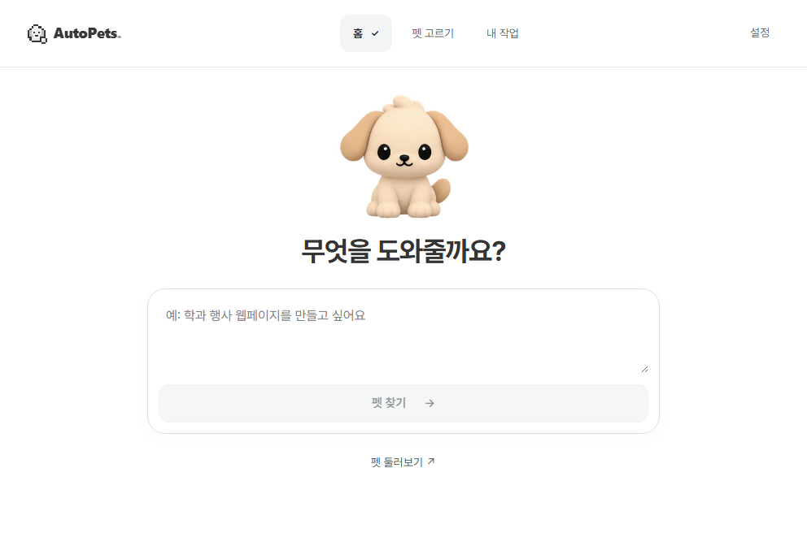
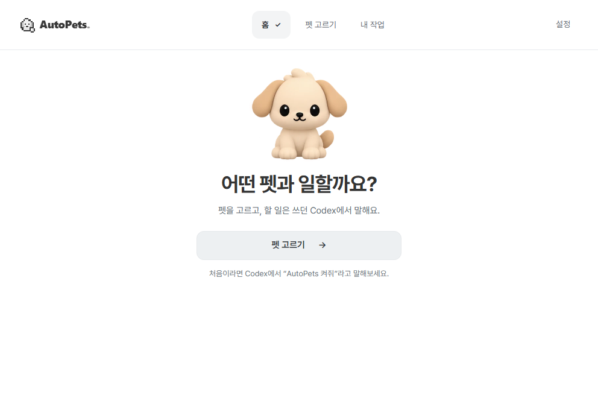
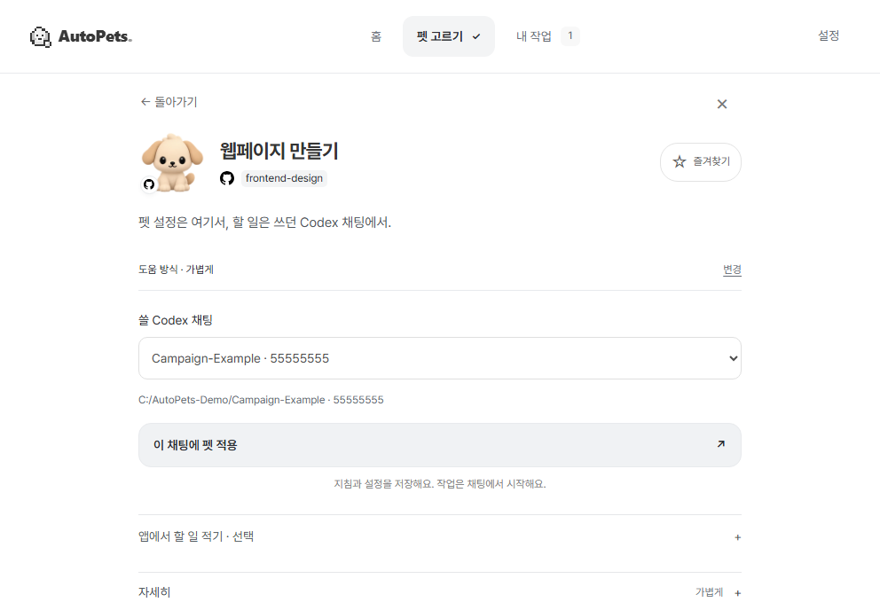
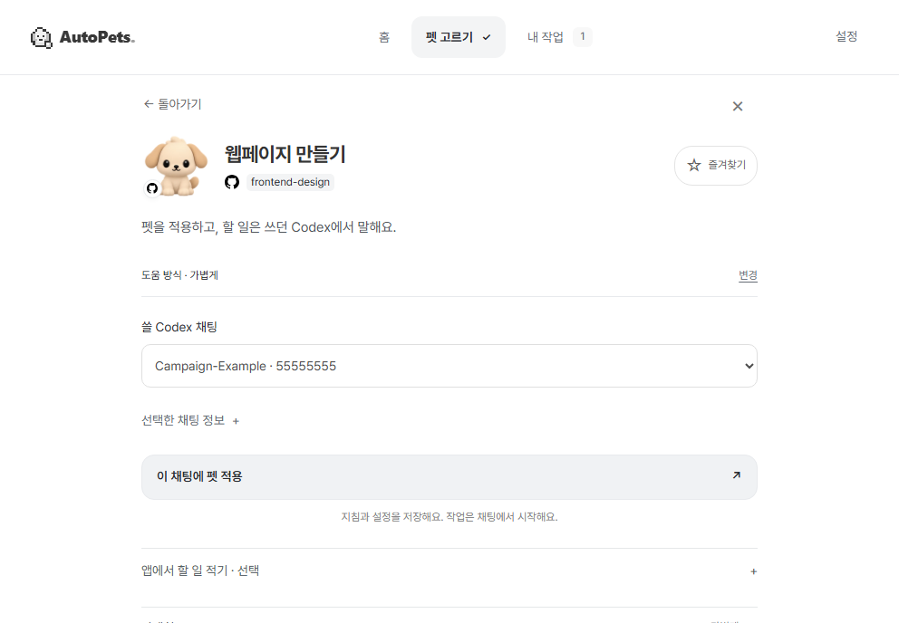
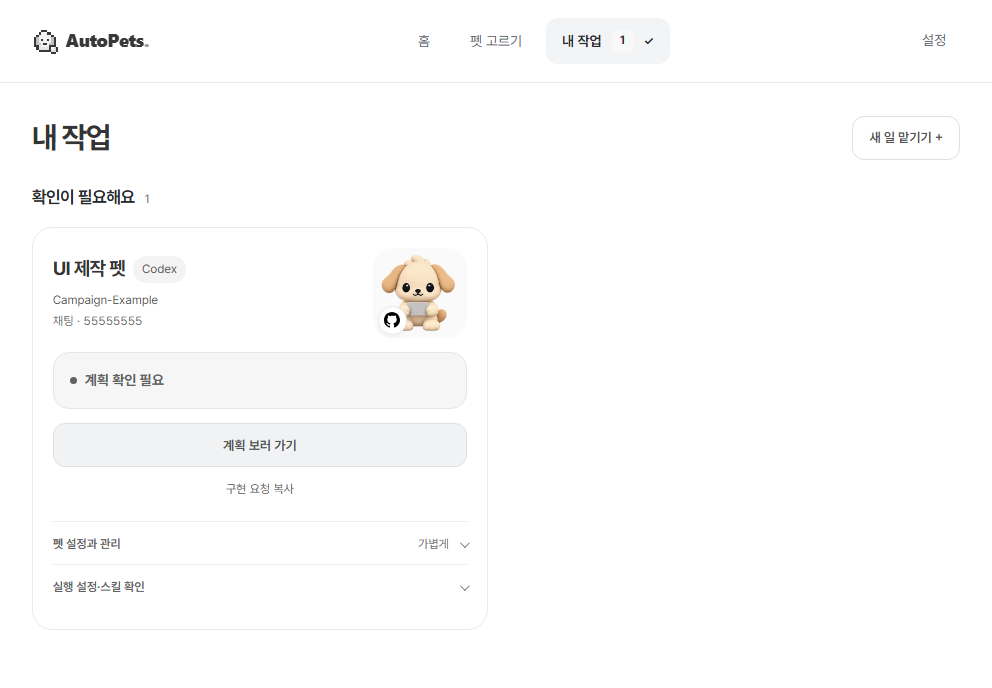
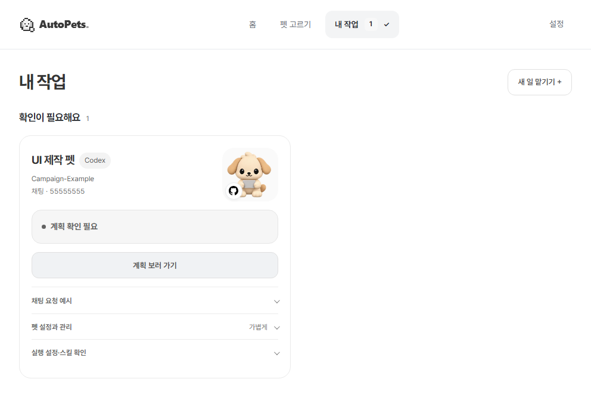

# PR #22 · 화면 추가 개선 전후

세 영역을 같은 조건으로 다시 연 브라우저 캡처다. **가상 연결·가상 작업을 사용한 UI 자료**이며 실제 Codex 실행, 설치 성공, 결과 품질 또는 사용자 편익의 증거가 아니다.

## 비교 기준

| 항목 | 기준 |
| --- | --- |
| Before | `d29c26f62835340a62e32f70c65d96b191d7c7df`의 앱·데이터·자산을 분리 추출하여 실행 |
| After | 제품·개발 도구 소스 `7de751be533961f051fbdc582f931b343212db5f`. 이후 공동 규격·검사·문서 변경은 캡처한 제품 화면을 바꾸지 않는다. |
| PR 기준과 차이 | PR #22의 병합 대상은 `f35e7b1`이다. 이 자료는 PR 전체가 아닌 **`d29c26f` 이후의 추가 화면 개선**을 비교한다. |
| 화면 조건 | 두 쪽 모두 **992×688 CSS px**, DPR 1, Chromium, 밝은 화면, 동작 줄이기, 같은 글꼴·언어·가상 데이터 |
| 렌더 환경 | 두 소스 모두 현재 설치된 동일 개발 의존성을 재사용했다. Before는 당시 설치본의 과거 캡처가 아닌, 기준 소스를 다시 연 화면이다. |
| 캡처 범위 | 첫 화면의 실제 뷰포트. 전체 페이지를 축소하거나 합성·보정하지 않음 |
| 보존 범위 | 기존 계정·작업·설치와 무관한 새 브라우저 세션. 실제 AI 실행 0회 |

홈은 연결된 작업이 없는 상태다. 펫 선택 화면에는 같은 가상 채팅 하나가 연결돼 있으며, 작업 카드에는 같은 **계획 확인 대기** 기록과 스킬 읽기 근거를 넣었다. 별칭·초안·즐겨찾기는 두 쪽 모두 비어 있다. `AutoPets-Demo`, `Campaign-Example`, 반복 숫자로 표시한 채팅 식별자는 모두 예시다.

## 홈 · 요청할 곳을 분명하게

앱의 작업 입력창 대신 펫 선택 버튼과 Codex에서 요청하는 안내를 우선한다.

| Before · 992×688 | After · 992×688 |
| --- | --- |
|  |  |

## 펫 선택·준비 · 필요한 정보부터

동일한 웹페이지 펫, 가볍게 설정, 가상 대상 채팅을 선택한 저장 전 상태다. 상세 경로와 식별 정보는 접어서 확인하고, 대상 선택과 적용 행동을 유지한다. 이 캡처에서 설정을 실제 저장하거나 작업을 실행하지 않았다.

| Before · 992×688 | After · 992×688 |
| --- | --- |
|  |  |

## 작업 카드 · 현재 작업으로 이어가기

같은 가상 계획 확인 대기 상태다. 정확한 채팅으로 돌아가는 주 행동을 유지하고, 선택형 복사 도움말은 ‘채팅 요청 예시’에 모았다. 버튼이 보이는 것은 실제 채팅 도착이나 자동 제출의 증거가 아니다.

| Before · 992×688 | After · 992×688 |
| --- | --- |
|  |  |

## 세 영역의 공동 전달 확인

현재 화면의 요소에서 가장 가까운 영역을 확인하고, 실제 소유 범위 검사로 담당 파일 목록과 다른 담당 파일의 거절을 대조했다.

| 선택한 요소 | 확인한 담당 | 파일 경계 |
| --- | --- | --- |
| `home.choose-pet` | `home` | 홈 담당 파일 허용, 다른 담당 파일 거절 |
| `pet-selection.detail.use` | `pet-selection` | 선택 담당 파일 허용, 다른 담당 파일 거절 |
| `task-card.return` | `task-card` | 카드 담당 파일 허용, 다른 담당 파일 거절 |

표식이 충돌하는 사례는 담당을 추정하지 않고 통합 담당자 검토 대상으로 남긴다. 이 검사는 **가상 요소의 분류와 파일 경계 확인**이며, 실제 사용자 의견이나 파일 쓰기 권한 잠금은 아니다. 브라우저→HTTP→MCP의 실제 피드백 왕복 검사는 [Agentation 검사 기록](../../testing/agentation-ui-collaboration.md)에 별도로 남긴다.

캡처 검사에서 페이지 오류·외부 요청·가로 넘침은 각각 0건이었다. 여섯 PNG의 크기를 직접 확인했고 공개 전에 내용을 검토했다. 원본 로그, 주석 본문, 로컬 설정, 개인 경로는 포함하지 않았다. [공동 작업 규칙](../../development/ui-collaboration.md) · [파일 소유 범위](../../development/ui-ownership.json)

검사일: 2026-10-28. 새 PC 설치·실제 Windows DPI·실제 채팅 실행·사용자 이해도는 이 자료의 확인 범위에 포함하지 않는다.
