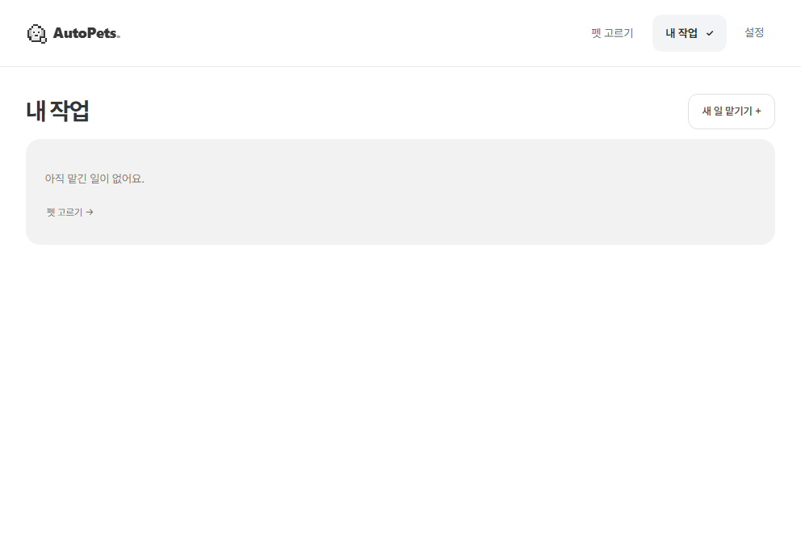
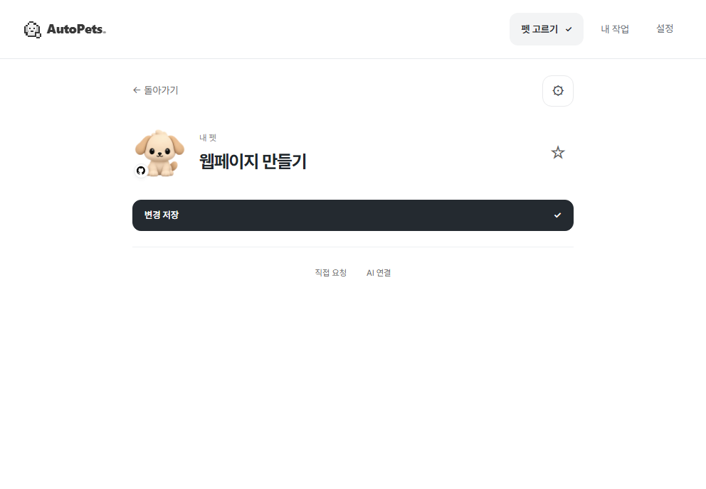
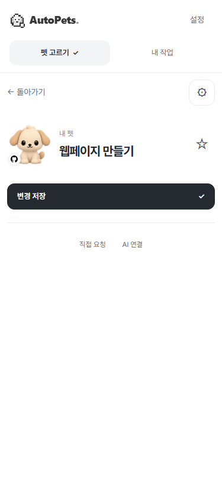

# 연결 설정을 보고 같은 펫으로 돌아오기

펫을 고르고 연결 설정을 확인한 뒤에도 같은 화면에서 계속할 수 있게 했습니다. 작성 중인 요청과 작업 방식, 선택한 채팅을 그대로 유지합니다. 저장한 펫의 설정을 바꾸는 중이라면 **내 펫 · 변경 저장**으로 표시합니다.

## 사용 순서가 어떻게 달라지나요?

| 이전 | 변경 후 |
| --- | --- |
| 펫 선택 → 연결 설정 → 내 작업 목록 → 다시 펫 찾기 | 펫 선택 → 연결 설정 → **펫으로 돌아가기** → 같은 화면에서 계속 |
| 저장한 펫을 수정해도 새 펫 / 펫 만들기로 표시 | 내 펫 / 변경 저장으로 표시하고 같은 펫을 갱신 |
| 설정 화면으로 이동하는 버튼이 Codex 연결로 표시 | **Codex 연결 설정**으로 표시해 버튼의 결과를 알 수 있음 |

아래는 **같은 가상 데이터·992×688 화면·100% 배율에서 연결 설정을 다녀온 직후**입니다. 실제 Codex 작업이나 설치 앱의 연결 성공 화면이 아닌 **합성 UI 검사**입니다.

| 이전 | 변경 후 |
| --- | --- |
|  |  |

375×812의 좁은 화면에서도 같은 펫으로 돌아옵니다.



## 이 방법을 선택한 이유

연결 설정은 지금 하던 편집을 잠깐 벗어나는 단계로 다뤘습니다. 돌아올 화면을 다시 만들거나 사용자가 입력한 내용을 별도로 저장하는 대신, 기존 편집 화면을 잠시 숨겨 유지합니다. 앱을 종료하면 사라지는 미저장 입력을 영구 복구하는 기능은 아닙니다.

펫 화면의 버튼과 앱 메뉴에서 연결 설정을 여는 경우 모두 원래 화면으로 돌아갑니다. 펫을 고르지 않았다면 원래 목록을 보여 줍니다. 연결 설정이 아닌 다른 화면을 직접 선택하면 그 선택을 우선합니다. 설정을 보는 동안 B 채팅의 연결이 끊겨도 A 채팅으로 임의 전환하지 않고, B에 대한 적용을 막습니다. 돌아오는 동작만으로 펫을 저장하거나 설정을 적용하거나 AI 요청을 보내지 않습니다.

## 확인한 내용과 남은 점

- 원래 main에서는 설정에서 돌아왔을 때 펫 화면이 닫히는 것을 재현했고, 변경 후 같은 검사에서 펫·입력·작업 방식과 키보드 초점이 유지됨을 확인했습니다.
- 타입 검사와 제품 빌드, 전체 합성 UI의 72개 점검 항목, 검수용 시제품과 오프라인 패키지 검사가 통과했습니다. 최종 코드의 연결 집중 검사 4개 항목도 통과했습니다. 점검 항목 수를 서로 다른 실제 사용자 시험 수로 세지 않습니다.
- 기존 펫을 수정해 저장하면 새 펫을 추가하지 않고 같은 ID의 개정이 증가합니다. 설정 중 B가 끊어지고 개정이 바뀌는 경우, 명시적인 다른 메뉴 이동, 좁은 화면도 확인했습니다.
- `pet-connection-return.webm`은 위 합성 검사의 녹화입니다. `pnpm test:ui`로 생성하며, 원격 Windows 검사가 완료되면 기존 **AutoPets-windows-review** 산출물에 포함됩니다. 영상은 Git에 넣지 않습니다.
- 이번 변경으로 실제 호스트 연결이나 자동 전송을 추가하지 않았습니다. 최신 설치판의 실제 첫 연결·같은 채팅에서 작업·정확한 복귀·모션 체감·사용자 편익은 별도 확인이 남아 있습니다.

<details>
<summary>개발 기록과 재현</summary>

관련 작업은 [Issue #40](https://github.com/swaan-kim/autopets/issues/40), 통합 담당은 swaan-kim입니다. 기준은 main `de5a974f2881d11f05648d07873cbb157e33ba3c`이며 변경 버전은 이 문서가 포함된 PR의 커밋과 Checks에서 확인합니다. 입력은 공개 가능한 가상 요청과 가상 A/B 채팅만 사용했습니다.

```powershell
pnpm build
pnpm test:ui
```

집중 확인은 `AUTOPETS_UI_QUICK_USE_ONLY=1`을 설정한 환경에서 같은 UI 명령을 실행합니다. 전체 검사를 다시 할 때는 이 값을 해제합니다. 기본 CI는 이 값을 설정하지 않아 전체 화면 검사를 유지합니다. 기존 Windows workflow·권한·실행 조건은 수정하지 않았습니다.

최초 추가 검사는 가상 연결 응답의 필수 설정 필드가 빠져 수정했고, 이후 정상 형태의 가상 응답으로 원래 문제를 재현했습니다. 연결 변경 검사는 화면이 새 스냅샷을 받은 것을 기다린 뒤 적용 차단을 확인합니다. 원본 실패와 수정 후 통과를 섞지 않습니다.

수정은 Manager의 화면 이동, 펫 준비와 연결 화면의 표시, 관련 UI 검사에 한정합니다. 앱 ID·DB·사용자 데이터·대상과 개정 재조회·중복 실행 방지·호스트 지원은 유지합니다. 실제 AI 호출·설치·계정/권한 변경·배포를 추가하지 않았습니다.

</details>
