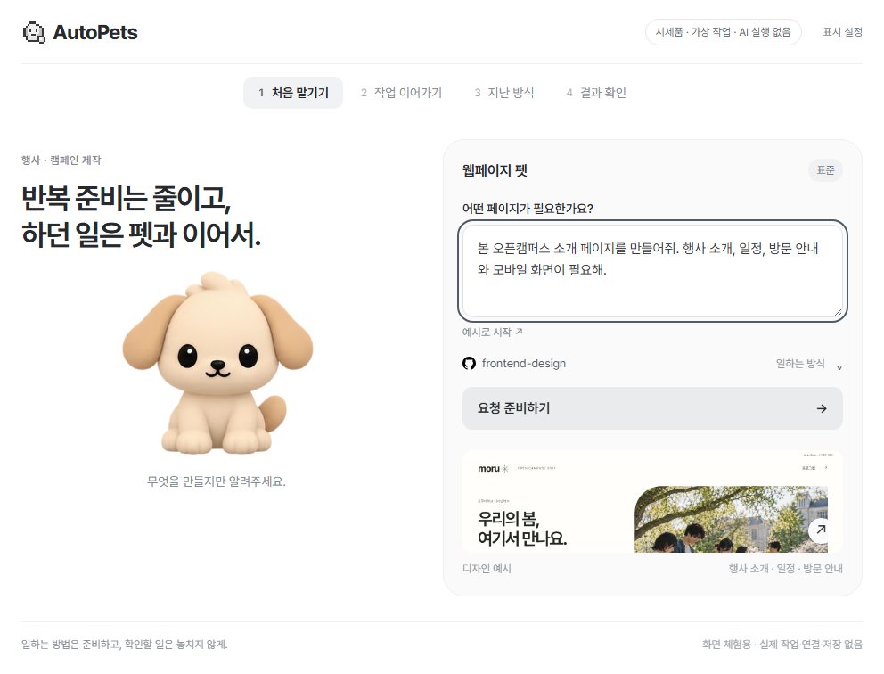
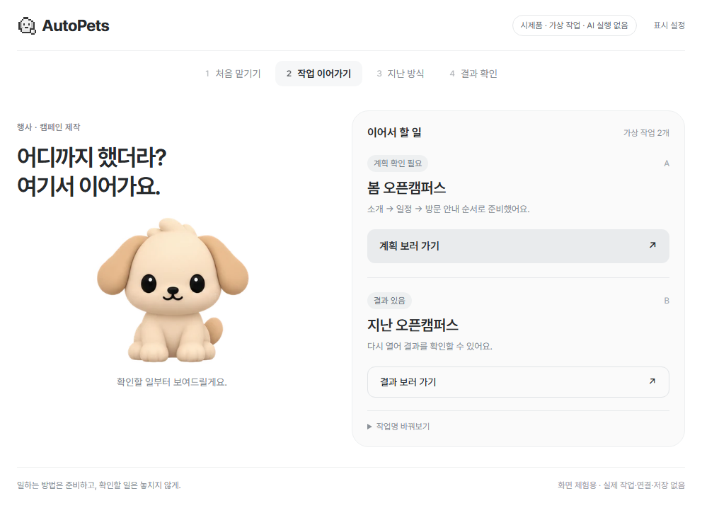
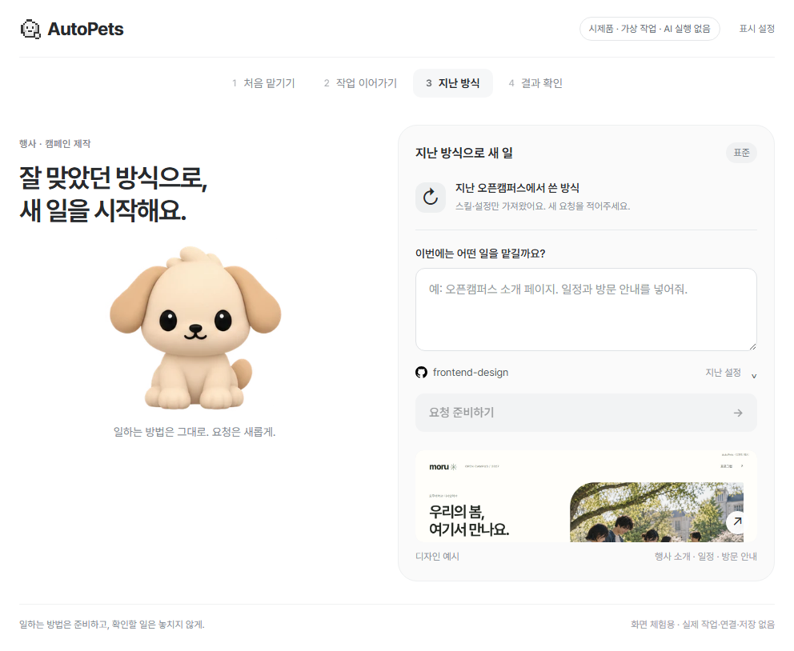
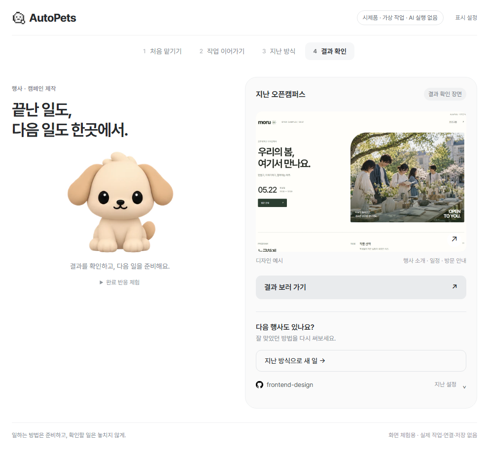
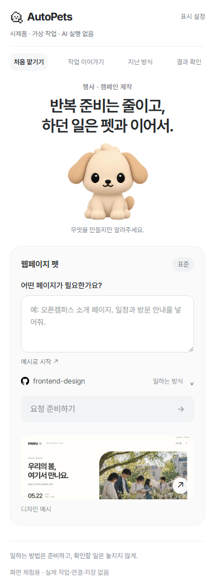

# 반복 업무 네 장면 — 화면 시제품

2026-10-19. **모두 합성 작업·디자인 예시이며 실제 Codex 실행 캡처가 아니다.**

| 장면 | 화면 |
| --- | --- |
| 처음 맡기기 |  |
| 작업 이어가기 |  |
| 지난 방식 |  |
| 결과 확인 |  |
| 작은 화면 |  |

[구현·검사·한계](../../testing/campaign-study-20261019.md) · [사용자 검사 키트](../../testing/campaign-user-study.md)
