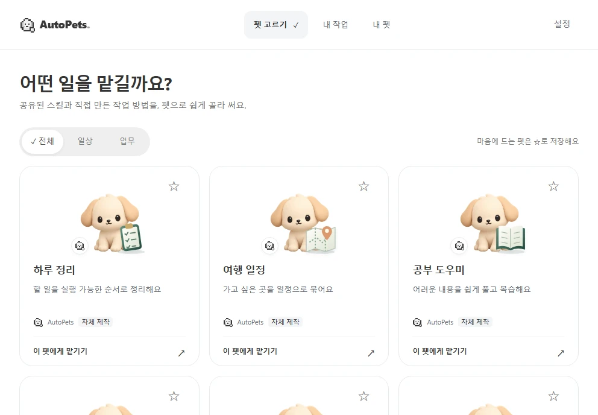
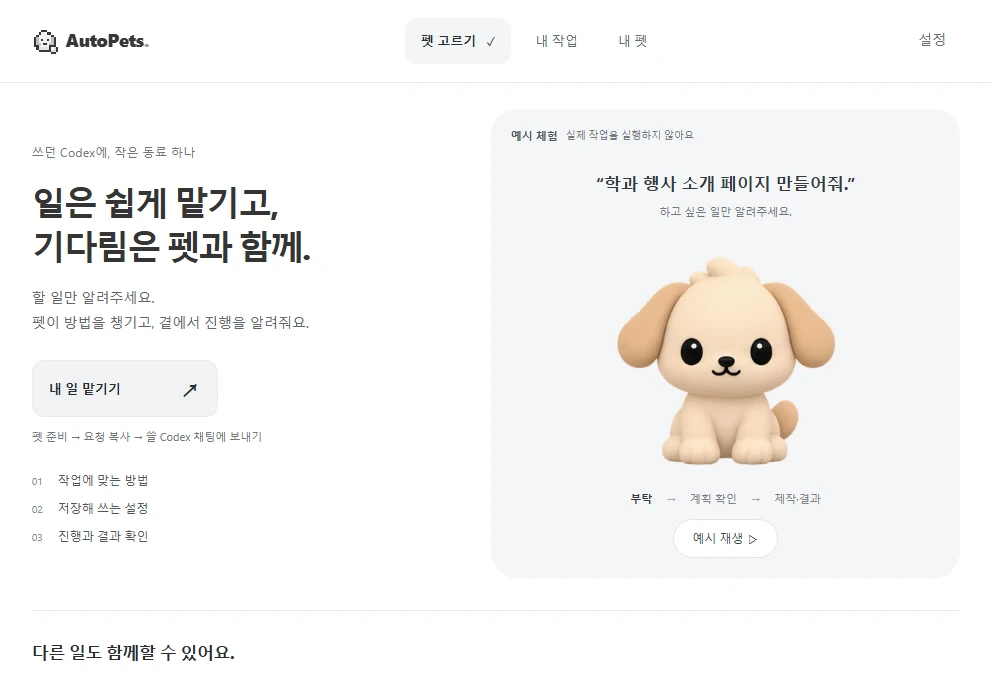
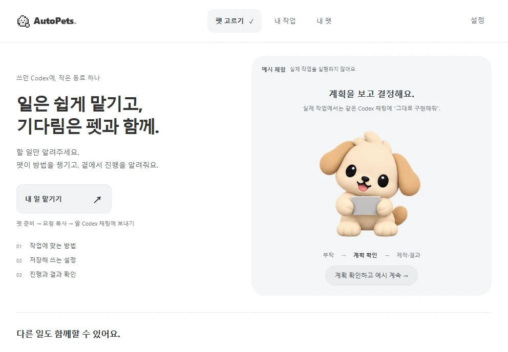
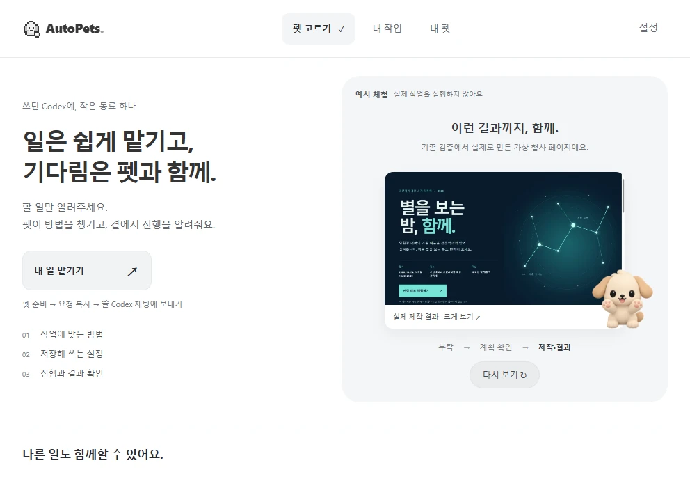

# 첫 화면과 동반 모션 — 화면 비교

모두 992×688 개발 브라우저 캡처다. 실제 AI를 실행하지 않은 **예시 체험**이며, 설치 앱·일반 사용자 검증 자료가 아니다. 결과 페이지 이미지만 2026-10-12 기존 실제 제작 결과를 재사용했다.

[짧은 체험·모션 영상](companion-demo.mp4) — 무음, 개발 화면 녹화. 계획 확인에서 멈추고 사용자가 계속한 뒤 결과 예시로 이어진다.

## 기존

## 새 첫 화면

## 계획 확인 대기

## 결과

[검사 범위·재현·남은 조건](../../testing/companion-20261013.md), [사용자 검사표](../../testing/companion-user-check.md).
