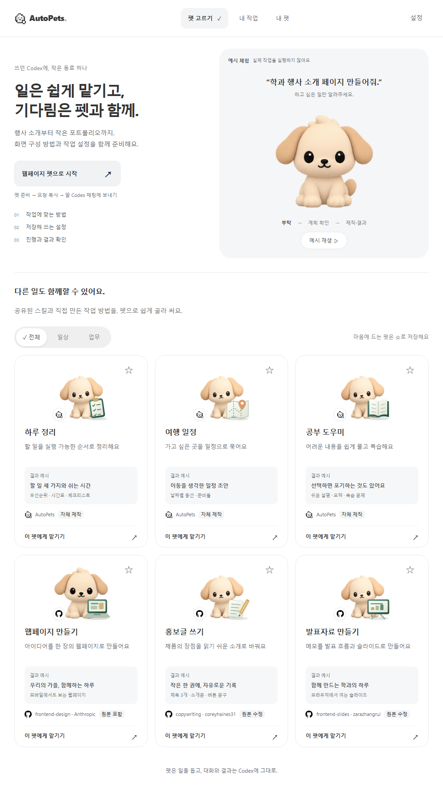
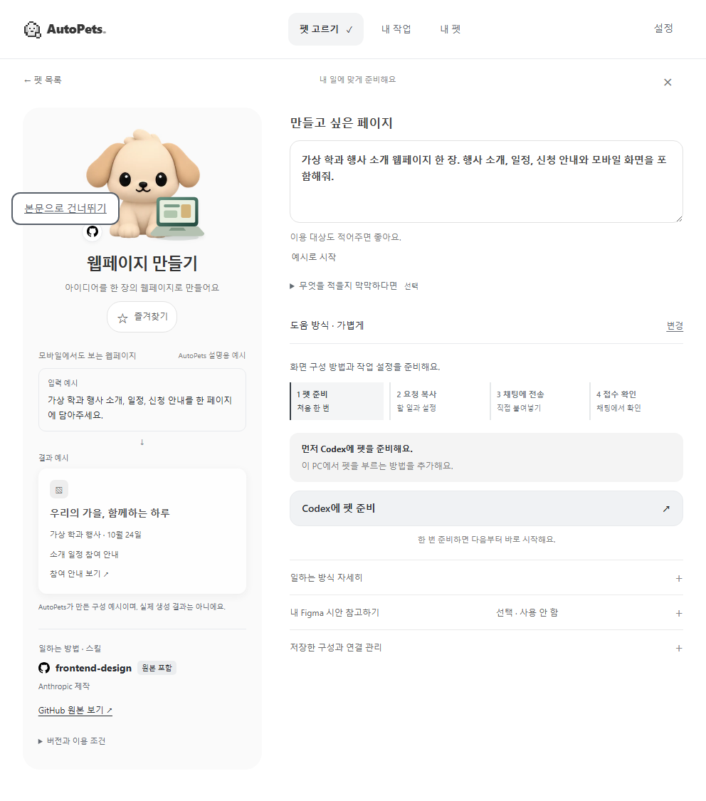
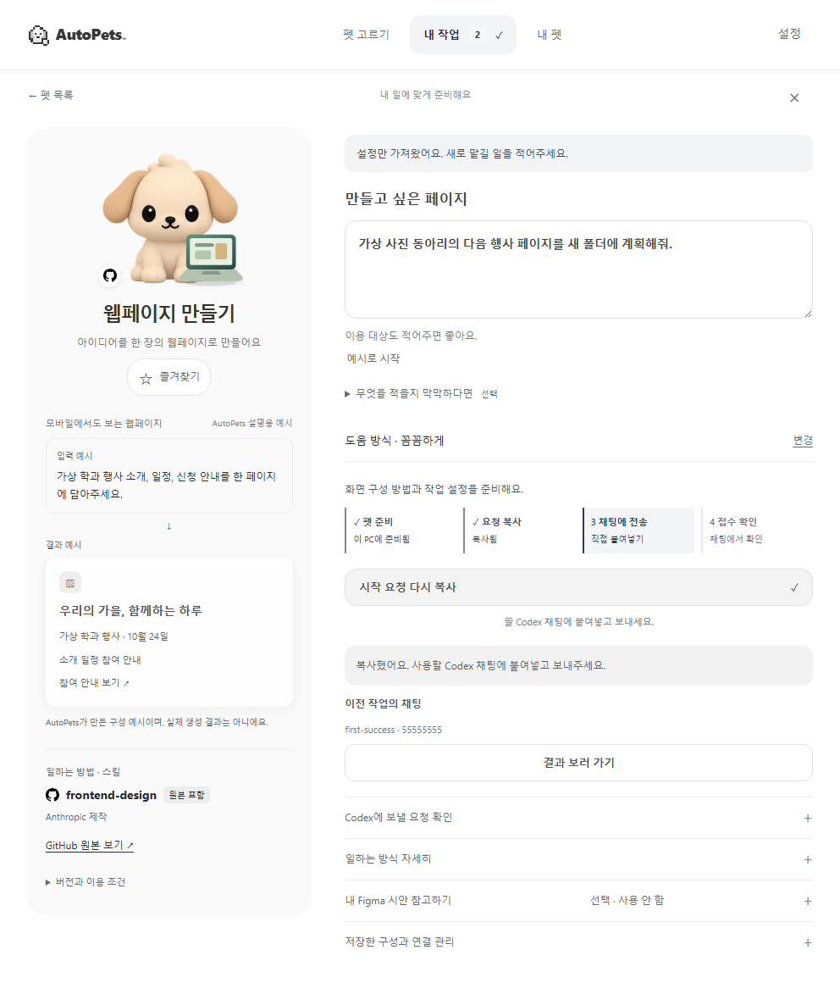

# 첫 성공과 두 번째 사용 — 화면 자료

2026-10-16, 992×688 개발 브라우저의 전체 페이지 캡처. **실제 앱 화면 코드와 합성 시험 상태**이며 설치 앱·사용자 체험·새 AI 실행의 증거는 아니다. 모든 요청과 대상은 시험용이다.

## 기존 첫 화면

같은 대표 펫과 예시 체험을 사용한 [10월 13일 화면](../companion-20261013/after.webp). 이번에는 모션을 늘리지 않고 대상이 명확한 시작 버튼과 다음 행동을 보완했다.

## 시작과 결과 예시

## 필요한 정보만 입력

## 같은 펫으로 새 일

이 화면은 새 요청을 작성·복사한 뒤의 합성 시험이다. 새 일 진입 시 본문은 비어 있으며 이전 요청·승인을 가져오지 않는다. **복사됨은 접수됨이 아니다.** 아래 결과 보러 가기는 등록된 이전 작업의 채팅에 열기를 요청한다.

[개발 검사 결과](../../testing/first-success-20261016.md) · [실제 사용자 검사표](../../testing/first-success-user-check.md)
