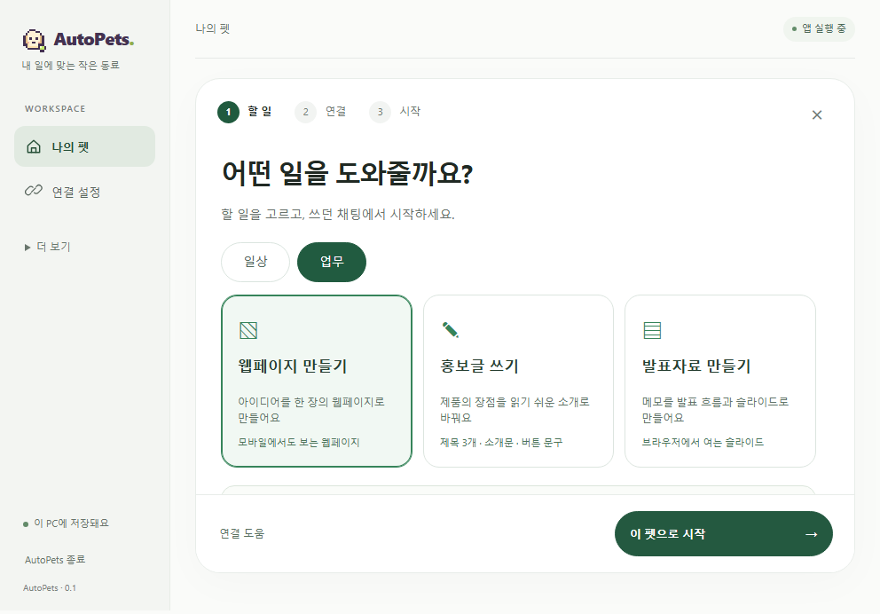
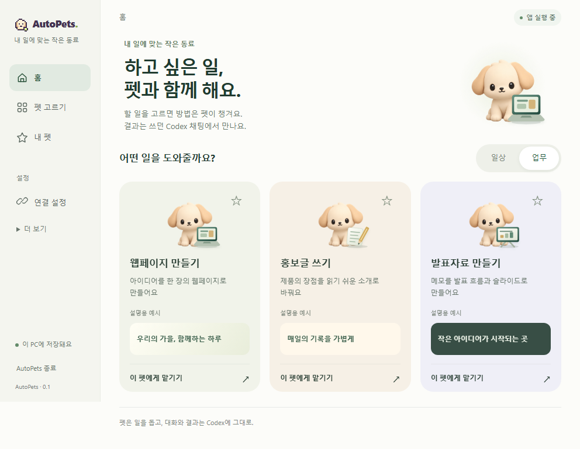
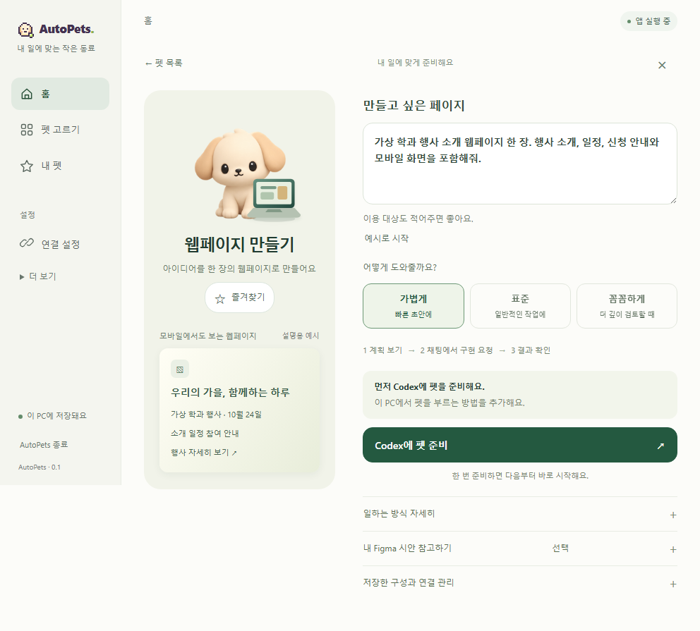
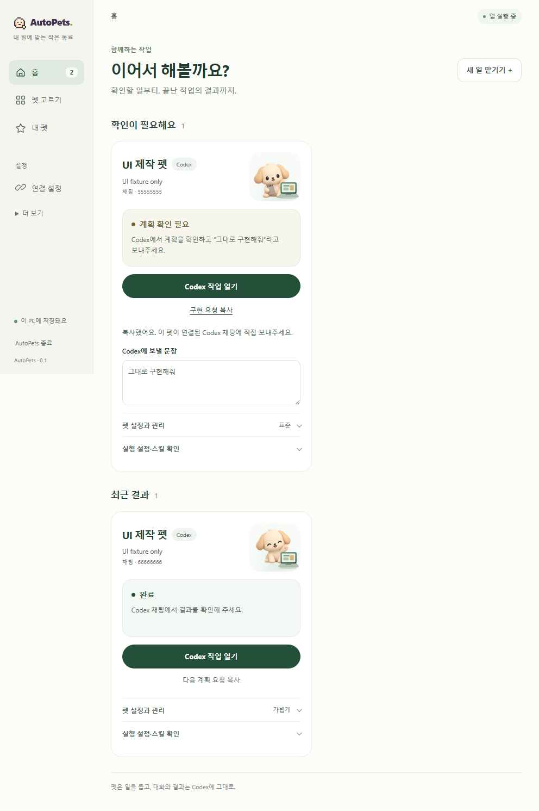

# UX 개편 전후 — 개발 화면

아래는 같은 브라우저 UI 검사에서 합성 상태를 넣어 촬영한 화면이다. 설치 앱·실제 작업 결과·사용자 사용성 검사로 계산하지 않는다. 화면의 ‘앱 실행 중’도 fixture에서 주입한 상태다. 개인 대화나 연결 인증값은 포함하지 않는다.

| 이전: 고정 단계 | 이후: 할 일을 먼저 선택 |
| --- | --- |
|  |  |

## 한 화면에서 준비

맡길 일과 일하는 강도를 고르고, 이 PC에 준비가 안 됐을 때만 Codex 준비를 표시한다. Figma와 실행 근거는 상세에서 확인한다.

## 다시 방문한 홈

확인할 작업부터 보여주며, 저장된 실제 실행 상태를 같은 카드에 연결하도록 구현했다. 아래 A/B는 검사용 가짜 대상이며 ‘계획 확인 필요’와 ‘완료’의 화면 예시다.

[검사와 실제 연동 판정](../../testing/ux-overhaul.md)
