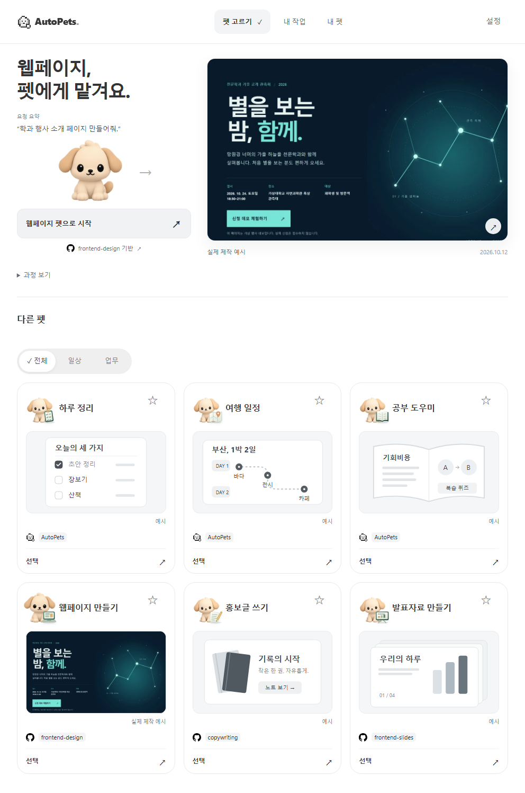
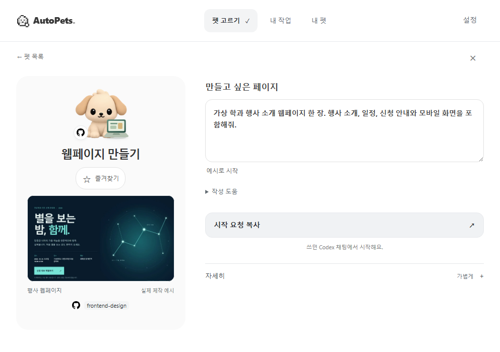

# 화면 단순화 전후 — 2026-10-17

992×688 브라우저 창에서 촬영한 전체 페이지다. 연결은 준비 완료 합성 fixture이며 새 실제 채팅 실행 캡처가 아니다. 웹페이지 결과 이미지 자체는 2026-10-12 실제 제작 결과를 재사용했다. 다른 역할 썸네일은 설명용 예시다.

| 화면 | 이전 | 이후 |
| --- | --- | --- |
| 첫 방문 | [이전 화면](before-home.png) | [결과 중심 화면](after-home.png) |
| 요청 준비 | [이전 화면](before-composer.png) | [입력·다음 행동 중심 화면](after-composer.png) |

상세 기본 접힘의 UI 글자는 첫 화면 180→78자, 요청 화면 398→88자다. [계측 방법과 검사 범위](../../testing/visual-simple-20261017.md)를 참고한다. 사용자 이해도나 품질·시간 절감 수치를 나타내지 않는다.

