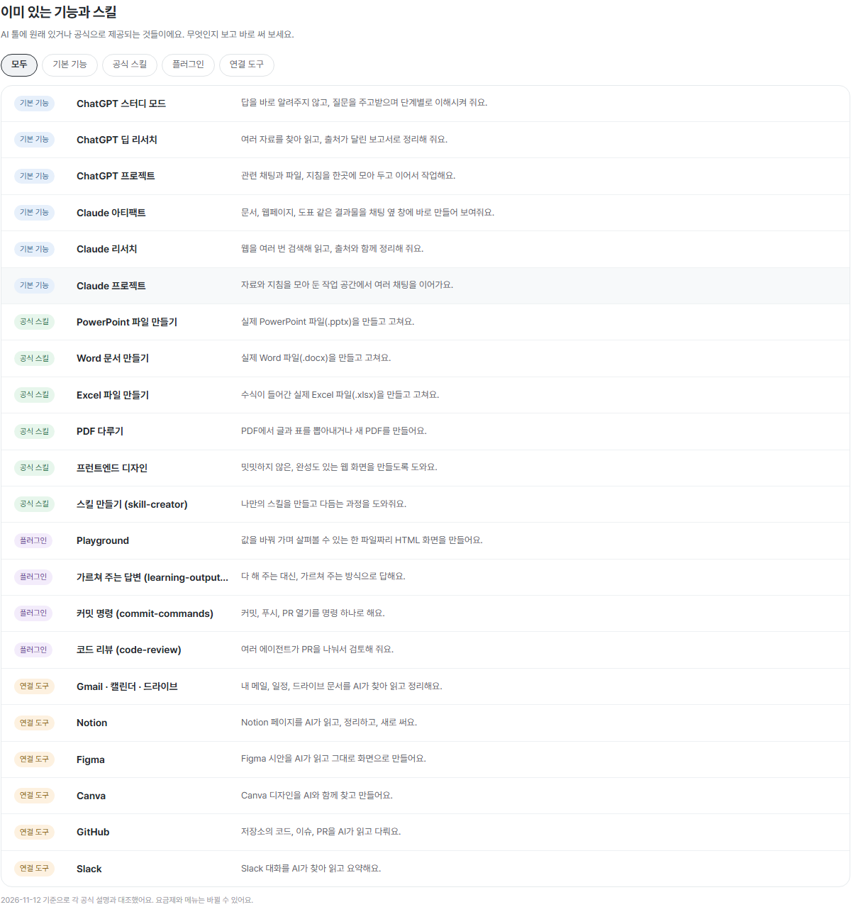
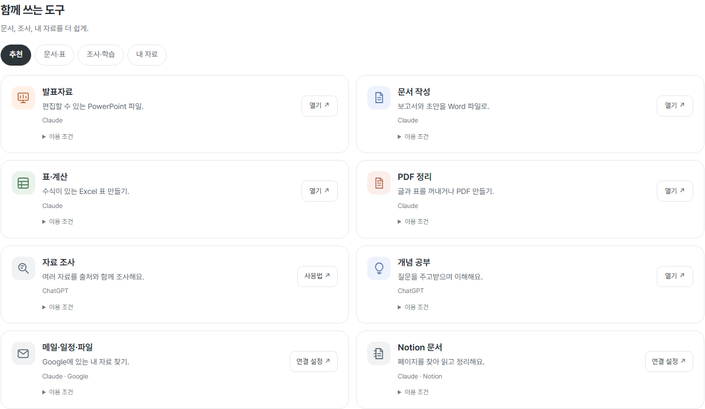
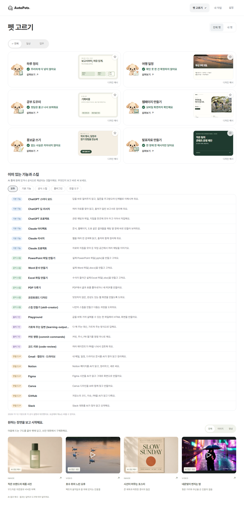
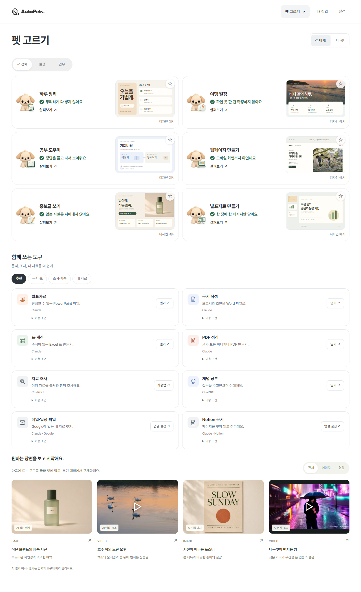

# 결과 예시와 도구 목록 검사

2026-11-15 · Issue #82 · 담당 승완. 이번 기록은 브라우저 화면의 **합성 검사**이며, 결과 미리보기 자체는 **디자인 예시**입니다.

## 비교 조건

- 기준: 최신 main `7f359de`를 포함한 #78 `b0ad3f1`과 #76 `b9496ce`를 합친 UI 기준 `2584b92`. 충돌은 가로형 카드와 그 아래의 최신 스킬 허브·이미지/영상 갤러리를 모두 유지하도록 해결했습니다.
- 다른 담당 체크아웃·브랜치·사용자 설정은 수정하지 않았습니다. 관련 없는 미병합 PR의 실행 경로는 합치지 않았습니다.
- 전후 동일한 Chromium 헤드리스 브라우저, 1280×900, 배율 1, 빈 저장 데이터, `펫 고르기 → 전체 펫`입니다. 커서·키보드는 브라우저 가상 입력만 사용했습니다.
- 추가 화면 폭: 992, 716, 390px. 창 크기 변경은 Windows의 실제 DPI 검사를 대신하지 않습니다.

| 검사 | 결과 |
| --- | --- |
| TypeScript와 Vite 제품 빌드 | 통과. 기존 500kB 청크 안내는 남아 있으며 이번에 번들 구조를 바꾸지 않음 |
| `node scripts/run-tests.mjs` | 382개 중 380 통과, 실패 0, 기존 건너뜀 2 |
| 기존 전체 `ui-smoke.cjs` | 79개 검사 묶음 통과, 브라우저 오류 0. 별도 소유 개발 서버와 `AUTOPETS_UI_URL`로 실행하여 기존 개발 서버는 사용·종료하지 않음 |
| 카드·상세·확대의 일치 | 6종 모두 같은 그림/텍스트를 사용. 카드 안 중첩 버튼 없음, 확대 후 Escape와 초점 복귀 통과 |
| 도구 목록 | 추천 8개, 문서·표 4개, 조사·학습 2개, 내 자료 2개. 개발용 설치 항목의 노출을 줄임 |
| 시작 동작 | 두 번 클릭해도 한 번 호출. 항목 ID·허용 대상만 전달. 사용법은 `source`, 연결 설정은 기존 `web` 대상으로 구분 |
| 기존 동작 | 즐겨찾기, 상세/선택/초안, 저장 개정, A/B 격리, 요청 보존, 실패 복구의 브라우저 회귀 검사 통과 |
| 화면 크기 | 1280·992·716·390px에서 페이지 가로 넘침 없음. 6종 예시를 상세 크기로 직접 확인 |
| 영역 검사·구조·링크 | 이번 UI 변경 파일의 `ui:scope pet-selection`, 저장소 구조 검사, 문서 링크 검사, `git diff --check` 통과 |

도구 목록의 새 `전체` 버튼이 기존 테스트의 전역 `전체` 선택과 겹친 것을 확인했고, 선별한 목록의 의미에 맞춰 `추천`으로 고쳤습니다. 수정 후 전체 브라우저 검사를 통과했습니다.

## 전후 화면

| 이전 | 변경 후 |
| --- | --- |
|  |  |
|  |  |

[992px](../changes/82/after-992.png) · [716px](../changes/82/after-716.png) · [390px](../changes/82/after-390.png) · [발표자료 상세](../changes/82/after-presentation.png)

예시별 확인: [하루 정리](../changes/82/after-preview-daily-plan.png), [여행](../changes/82/after-preview-travel-plan.png), [공부](../changes/82/after-preview-study-helper.png), [웹페이지](../changes/82/after-preview-ui-webpage.png), [홍보글](../changes/82/after-preview-marketing-copy.png), [발표자료](../changes/82/after-preview-presentation.png).

## 확인의 한계

이번 변경은 화면·예시·참고 자료입니다. Rust·공개 API·DB·라우팅·인증·사용자 설정을 새로 수정하지 않았습니다. 도구 원본 데이터와 실행 허용 목록도 유지했습니다. 실제 설치 앱에서의 열림, AI 결과 품질, Windows 네이티브 DPI, 사용자 편익은 이번 합성 검사로 통과시키지 않습니다. 실제 AI·하위 작업·이미지 생성은 추가 0회입니다. 설치·배포·main 병합도 별개입니다.

Windows CI의 최신 결과는 PR의 Checks에서 확인합니다. #76의 기존 통과나 #78의 기존 실패를 이번 추가 변경의 검사 결과로 재사용하지 않습니다. 이번 작업에서 조정한 영역별 파일 목록은 #76에서 남겨 둔 카드·결과 예시 파일의 담당 공백도 함께 정리합니다. 공통 컴포넌트에서 바꾼 부분은 결과 미리보기이며 펫 모션 로직은 수정하지 않았습니다.

[UI 참고 자료와 적용 이유](../product/ui-reference-library-20261115.md).
