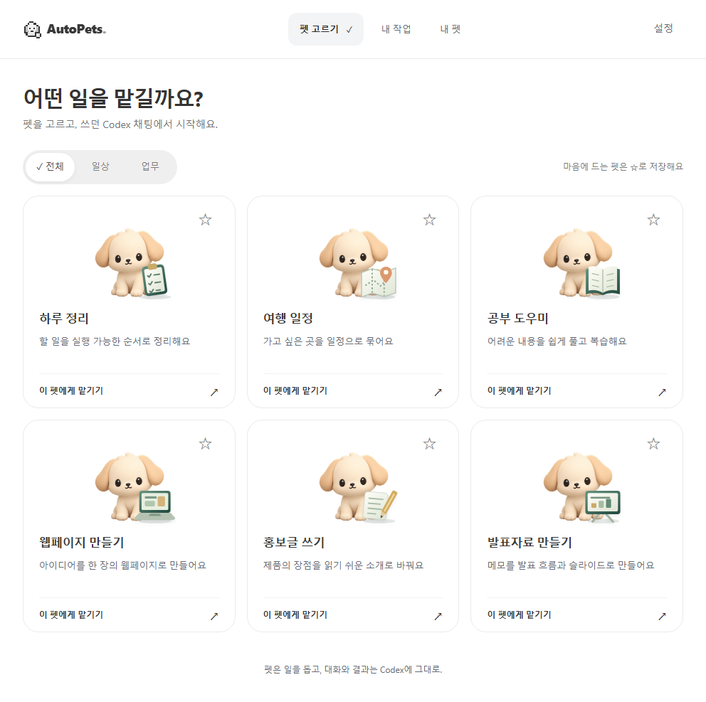
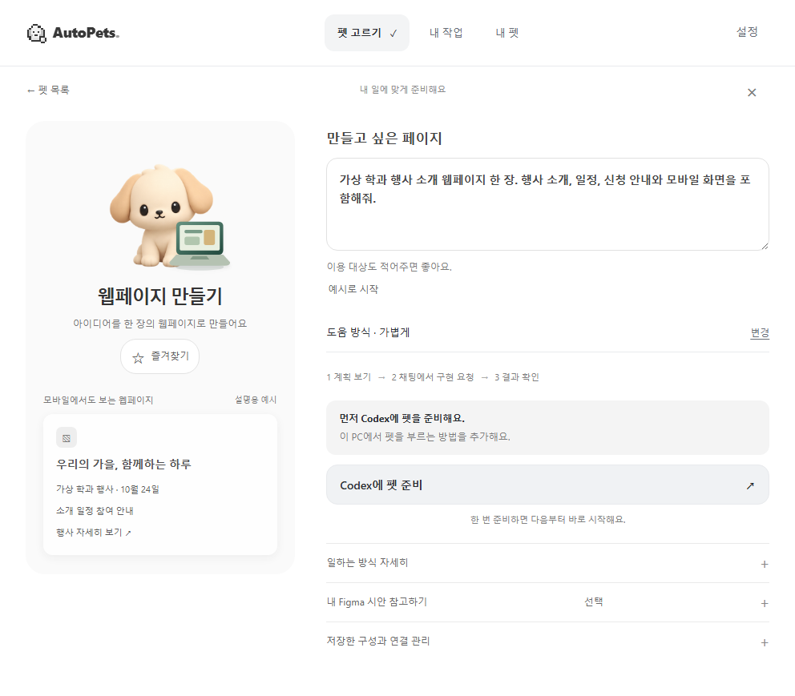
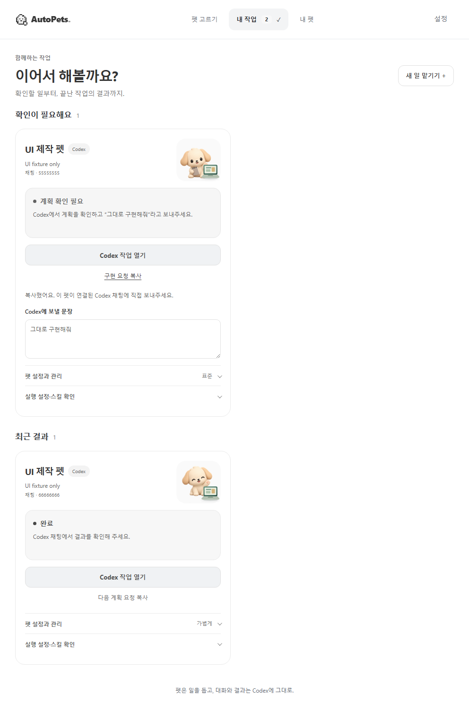

# 뉴트럴 UI와 설치·역할별 실행 검사

2026-10-11 승인한 A 뉴트럴 시안을 적용했다. 기존 공개 API, DB, 앱 식별자, 펫 자산과 실행 설정은 유지한다. 이전 초록·크림 중심 시안을 대체한다.

## 구현

- 상단 메뉴: 펫 고르기 · 내 작업 · 내 펫. 연결·복구·기존 작업 진단·고급 기능·종료는 설정에 모았다.
- 첫 방문: 여섯 역할 전체. 일상·업무 필터, 즐겨찾기, 같은 입체 펫의 역할별 소품을 유지한다.
- 재방문: 실제 저장된 연결이 있을 때 내 작업에서 확인 필요 → 진행 중 → 최근 결과를 보여준다.
- 작업 준비: 할 일 입력과 설명용 결과 예시. 기본 도움 방식은 한 줄로 표시하고 변경 시 세 가지 선택을 펼친다.
- 흰색 바탕, 옅은 회색 선택·주 버튼, 차콜 글자, 선택 체크와 명확한 키보드 초점. 설정·연결·오버레이도 같은 색 체계다.
- 저장·재조회 후 시작 요청 복사. 복사를 연결 완료로 표시하거나 자동 전송하지 않는다. 실제 등록된 대상만 정확한 채팅 열기를 제공한다.
- 목록에서 선택하면 준비 화면 맨 위로 이동한다. 뒤로 가면 목록 위치·초안·프로필·초점을 복원한다.

## 재현과 판정

`pnpm test`, `pnpm build`, `pnpm test:ui`, `pnpm verify:layout`로 기존 회귀와 새 화면을 검사한다. 브라우저 검사에는 합성 상태를 사용하며 설치 앱이나 실제 AI 결과의 증거가 아니다.

| 관문 | 현재 결과 |
| --- | --- |
| Node | 로컬 227 통과, 선택형 1 건너뜀. 기존 미커밋 연결 오류 검사 포함 |
| 빌드·화면 | 최종 빌드·전체 UI 회귀 통과, 페이지 오류 0 |
| 화면 조건 | 992×688, 794×550, 661×459, 375×812. 실제 Windows 배율 변경과 별도 |
| 설치 | 새 커밋의 Windows 산출물 확인 후 현재 PC 업데이트 예정. 보안 설정 유지 |
| 실제 역할 실행 | 57/72에서 시작. 새 부모·자식 시험은 아직 없음 |
| 사용자 이해도 | 처음 보는 사람의 직접 사용 미검증 |

AI 시험 배분: 웹페이지 계획·구현 4, 하루·여행·공부·홍보글 각 2, 발표자료 계획 2, 상태 복구 1. 총 15턴을 넘지 않는다. 내부 메시지 전달은 일반 입력창의 수동 전송 성공과 구분한다. 발표자료 구현은 이번 배분에 포함하지 않는다.

원본 진단·백업·실행 예산은 Git에서 제외한 `work/mvp-goal/20261011-neutral/`에 둔다. 설치·화면·역할별 실행·사용자 이해도를 각각 판정하고, 미검증 항목은 성공으로 승격하지 않는다.

## 비교 화면

[이전 화면](../images/ux-20261011/home.png)과 아래 화면은 모두 브라우저 합성 검사 캡처이며 설치 앱·실제 결과가 아니다.

