# 펫 고르기와 상세 화면 검수

스킬을 고른 다음, 어떤 결과를 만들 수 있고 어디에서 시작하는지 쉽게 알 수 있도록 상세 화면을 정리했다. 사람 담당자는 승완(swaan-kim), 관련 작업은 [#123](https://github.com/swaan-kim/autopets/issues/123)이다.

## 사용 흐름과 비교 화면

1. ‘펫 고르기’의 ‘둘러보기’에서 맡길 일과 대표 예시를 살펴본다.
2. 카드를 누르면 큰 예시가 열린다. 시간 배치, 둘째 날, 복습 문제 등 원하는 부분을 골라 확대할 수 있다.
3. 맡길 일을 적고 시작한다. 결과 아래의 ‘예시 요청 보기’에서 입력을 채워 편집할 수 있고, 스킬 출처는 따로 펼쳐 본다.

요청·결과 예시는 가상 상황으로 미리 작성한 **디자인 예시**다. 예시를 살펴보는 동안 앱은 연결과 실행을 요청하지 않는다.

| 이전 | 변경 후 |
| --- | --- |
|  | 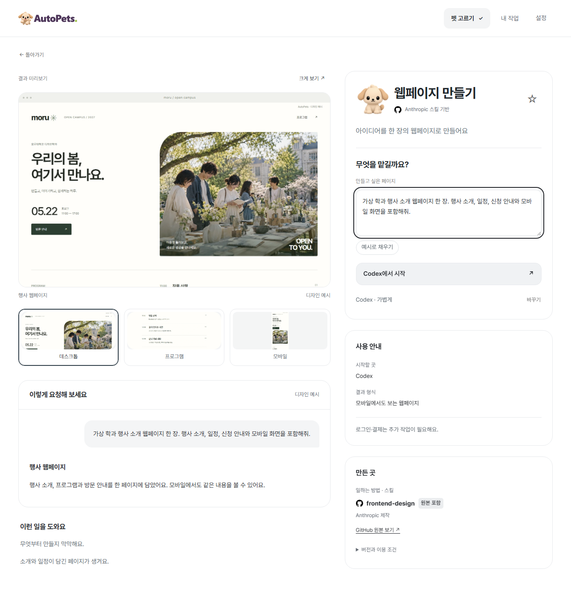 |

두 화면은 같은 가상 행사 웹페이지 요청, 같은 저장·연결 상태, 1280×960 창, 배율 100%, 같은 글꼴과 브라우저에서 찍었다. 아래까지 보이도록 전체 페이지를 캡처했으므로 변경 후 이미지가 더 길다. 이전 화면은 시작 시점의 main(`f87334e7bc74c7e5ca4f730b3d6753a276b8ec40`), 변경 후는 이 PR의 구현이다.

[작은 창 화면](../changes/123/after-compact.png)은 992×688, 같은 입력과 상태다. 제목이 한 글자만 다음 줄로 떨어지지 않도록 다듬었고 시작 버튼까지 보인다. 760px 이하에서는 긴 예시보다 시작 카드가 먼저 나온다.

## 참고한 구성과 선택 이유

사용자가 제공한 [Agensi 상세 화면](https://www.agensi.io/skills/markov-multi-touch-attribution-budget-reallocation)을 기준으로 큰 미리보기와 썸네일, 오른쪽 소개·시작 카드, 아래의 요청·결과 예시를 배치했다. 색은 AutoPets의 기존 중성색과 브랜드 색을 유지했다.

Mobbin에서 확인한 [Base44](https://mobbin.com/screens/99003e47-b929-4a2b-9f3b-c6935042114d?utm_source=chatgpt&utm_medium=ai-assistant&utm_source_platform=mcp)의 미리보기와 시작 카드, [Notion](https://mobbin.com/screens/db686263-c5af-44cb-b9db-d1b8727d2616?utm_source=chatgpt&utm_medium=ai-assistant&utm_source_platform=mcp)의 갤러리와 상세 정보 구분, [ChatGPT](https://mobbin.com/screens/d9831938-eb61-4a95-b56f-9c0bde421cfc?utm_source=chatgpt&utm_medium=ai-assistant&utm_source_platform=mcp)의 요청·결과 예시 배치를 함께 참고했다. 참고 서비스의 화면 이미지는 제품이나 공개 자료에 넣지 않았다.

큰 예시 옆에 소개와 시작을 모았다. PowerPoint 파일로 변환할 수 없는 경우처럼 결과에 영향을 주는 제한은 시작 버튼 옆에서 볼 수 있다. 초기 상세 구성과 이후에 접은 항목은 아래 비교에서 확인할 수 있다.

## 확인한 내용

Windows에서 기존 Playwright 검사 도구와 가상 연결 데이터를 사용했다. 실제 Codex·Claude를 호출하지 않았고 제품 AI 시험은 0회다.

| 검사 | 결과 |
| --- | --- |
| 프런트엔드 빌드 (`pnpm build`) | 통과. 기존 큰 번들 안내가 남는다. |
| Node 검사 (`pnpm test`) | 423개 중 421개 통과, 2개 건너뜀, 실패 0개. 건너뛴 항목은 실제 Codex CLI와 설치 파일 서명 검사다. |
| 전체 앱 UI 검사 (`ui-smoke.cjs`) | 76개 통과, 페이지 오류 0개. 여섯 펫의 갤러리·확대·키보드 조작, 초안·저장 구성, 대상 전환과 기존 시작·복귀 흐름을 포함한다. |
| 소개 페이지 UI·빌드·파일 패키지 검사 | 모두 통과. 외부 요청과 실제 AI 호출 없이 확인했다. |
| 담당 범위 검사 (`pnpm ui:scope`) | pet-selection의 제품·검사 파일과 home의 기존 UI 검사 파일 확인 완료. |
| 소개 생성 도구 검사 | 22개 통과. 생성물 31개의 재현 검사 통과. |
| 공백 검사 (`git diff --check`) | 통과. |

갤러리 검사는 키보드로 고른 예시가 확대 창에도 유지되고 Escape 후 원래 버튼으로 돌아오는지 확인한다. 예시를 보는 동안 실행·저장·연결을 요청하지 않는지, 이미지가 없어도 입력할 수 있는지도 확인했다.

검사 중 기존 main의 로고 변경 이후 `docs/demo/index.html`이 생성 원본과 달라 자동 검사가 실패하는 것을 재현했다. 기존 `docs/design-source/build-assets.cjs`로 해당 생성물만 맞췄다. 생성 도구나 로고 원본, 모션은 바꾸지 않았다.

## 작업 카드와 목록 펫 후속 확인

작업 카드의 기본 정보에는 펫 이름과 Codex 채팅 제목이 보인다. 이름을 가져오지 못한 채팅은 식별 번호로 대신 표시하지 않는다. 폴더와 채팅 ID는 기존 ‘실행 설정·스킬 확인’에서 볼 수 있다.

| 이전 | 변경 후 |
| --- | --- |
| 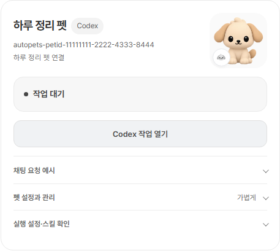 | 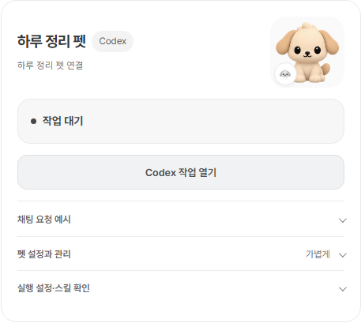 |
| 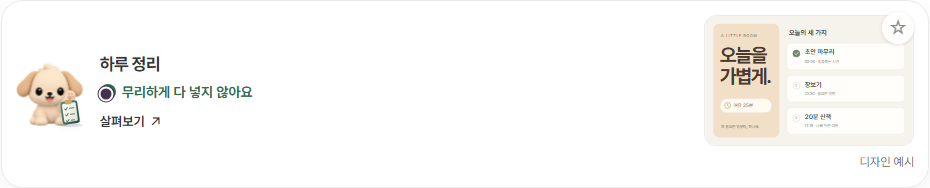 | 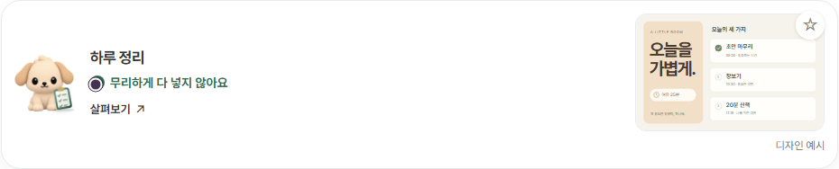 |

‘펫 고르기’의 캐릭터는 마우스를 올리거나 키보드로 초점을 옮겼을 때 살짝 기울고, 초점이나 마우스가 떠나면 원래 자세로 돌아온다. 펫과 소품이 같이 움직인다. 동작 줄이기 설정에서는 같은 자세로 머문다.

같은 ‘하루 정리’ 펫과 가상 채팅에서 배율 100%로 비교했다. 작업 카드는 992×688, 목록 펫은 992×420 창에서 해당 카드만 잘라 냈다. 보라색 점은 비교 화면의 마우스 위치다. 이전과 변경 후 모두 **합성 검사** 화면이다.

후속 변경 뒤 빌드와 전체 앱 UI 검사 76개가 통과했다. 키보드 초점, 동작 줄이기, 원래 자세 복귀, 채팅 이름 없는 카드, 원래 채팅의 대상과 개정 번호, 열기 실패 시 ID 복사 경로를 확인했다. 앞선 GitHub Windows 검사는 오버레이 알림 표시를 기다리다 시간 초과됐고, 같은 검사는 이번 로컬 전체 검사에서 통과했다.

## 결과 예시 다시 만들기

작은 썸네일 속 글자를 읽기 어려워 카드의 예시 공간을 넓혔다. 992px 창에서 너비가 210px에서 490px로 늘었다. 카드 높이도 늘어 한 번에 보이는 카드 수는 줄지만, 상세에 들어가기 전에 결과를 읽고 비교할 수 있다. 740px 이하에서는 예시가 소개 아래로 내려온다. 즐겨찾기 버튼은 예시 밖에 놓았다.

| 이전 목록 | 변경 후 목록 |
| --- | --- |
| 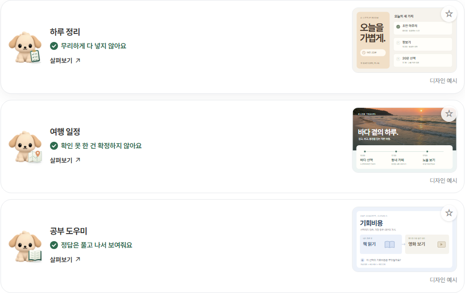 | 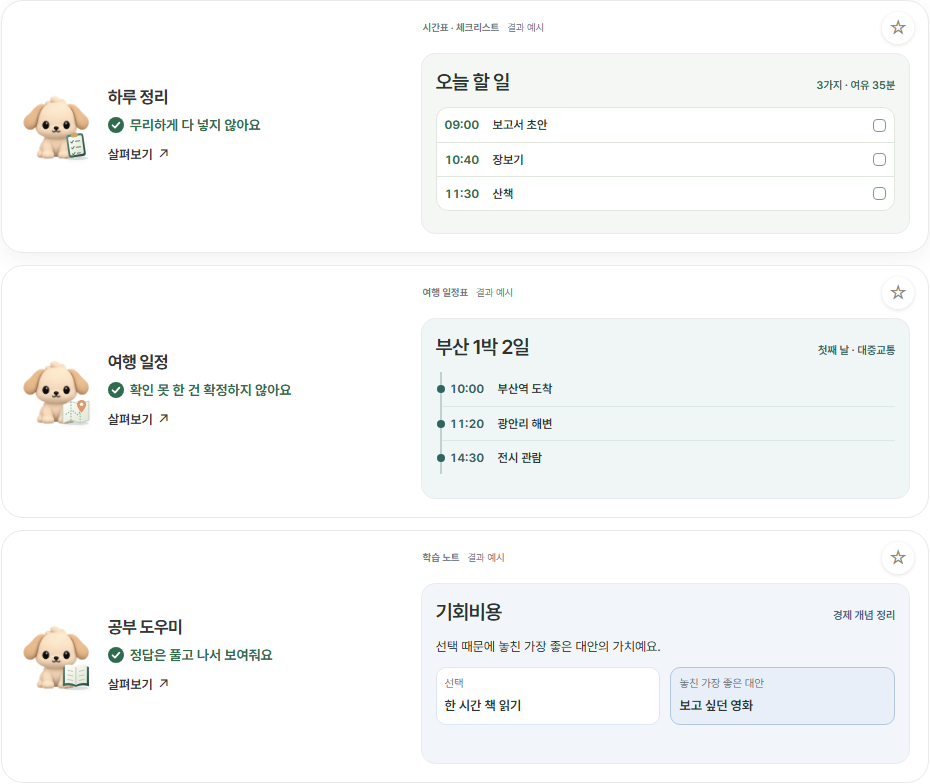 |

[업무 펫 결과 예시](../changes/123/after-examples-work.png) · [상세의 시간 배치 예시](../changes/123/after-example-detail.png)

| 펫 | 목록에서 보는 결과 | 상세에서 이어 보는 내용 |
| --- | --- | --- |
| 하루 정리 | 오늘 할 일 세 가지 | 3시간을 일과 여유로 나눈 시간 배치 |
| 여행 일정 | 부산 1박 2일의 첫날 동선 | 둘째 날 일정 |
| 공부 도우미 | 기회비용 설명과 선택 사례 | 복습 문제 세 개 |
| 웹페이지 만들기 | 가상 행사 웹페이지 | 실제 페이지의 프로그램 일정표와 모바일 캡처 |
| 홍보글 쓰기 | 행사 안내 서비스 소개와 버튼 문구 | 제목 후보 세 개 |
| 발표자료 만들기 | 학과 행사를 소개하는 첫 장 | 브라우저 발표자료 다섯 장의 흐름 |

목록 전후 이미지는 이 작업의 직전 커밋(`5c5be60`)과 변경 후 소스에서 같은 일상 필터·992×688 창·배율 100%로 캡처했다. 375·661·992·1280px 창에서 목록이 가로로 넘치거나 즐겨찾기 버튼이 예시와 겹치지 않는 것을 확인했다. 375px에서도 복습 문제를 확대해 끝까지 읽을 수 있었다.

갤러리와 확대에는 같은 예시 자료를 사용한다. 웹페이지 일정표는 저장소의 가상 행사 HTML을 렌더해 캡처했고, 발표 첫 장에는 기존 행사 사진을 사용했다. 빌드와 전체 앱 UI 검사 76개가 통과했다. Node 검사는 421개가 통과했고 실제 CLI와 설치 서명 검사 2개를 건너뛰었다. 앞선 Windows 검사에서 실패한 ChatGPT 패키지 연결 검사도 로컬에서 통과했다.

## 목록과 시작 화면 간소화

‘둘러보기’에서는 펫 이름, 맡길 수 있는 일, 결과 예시를 먼저 읽는다. 카드를 누르면 상세가 열린다. AI 도구와 이미지·영상 아이디어는 목록 아래에서 펼친다. 이미지·영상 갤러리는 펼쳤을 때 표시한다.

상세에서는 입력칸 이름 옆의 ‘예시 넣기’로 내용을 채워 바로 고칠 수 있다. 결과에 영향을 주는 제한은 시작 버튼 가까이에 둔다. 요청과 결과 예시, 스킬 출처는 갤러리 아래에서 각각 펼쳐 볼 수 있다. 좁은 창에서는 입력과 시작 버튼부터 나오므로 큰 예시는 그 아래에서 볼 수 있다. 미리보기를 먼저 살펴보던 사람에게는 좁은 창에서 한 번 더 스크롤이 필요하다.

| 이전 | 변경 후 |
| --- | --- |
| 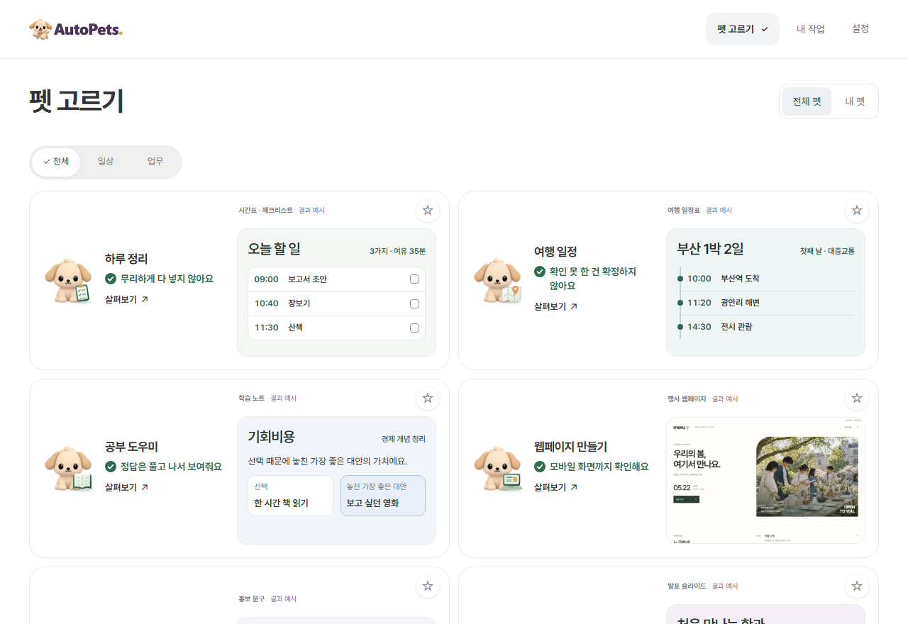 | 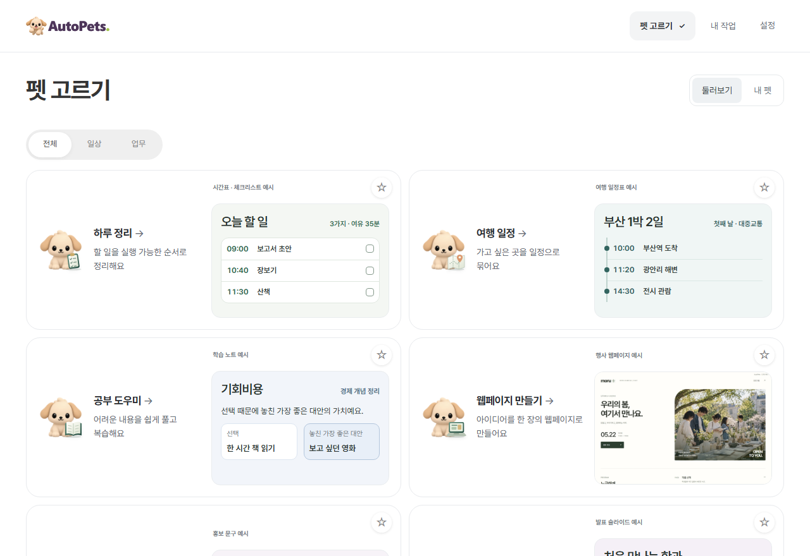 |
| 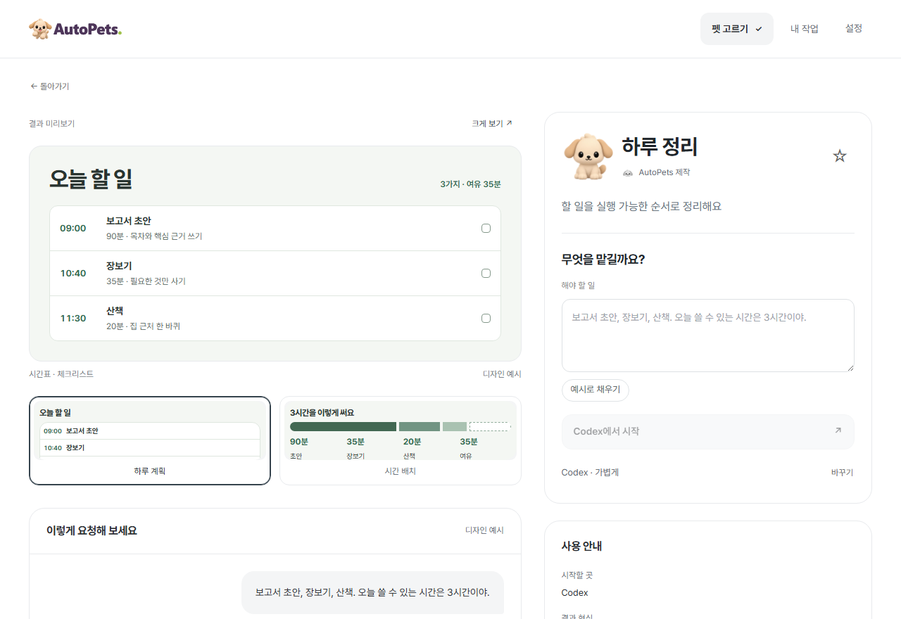 | 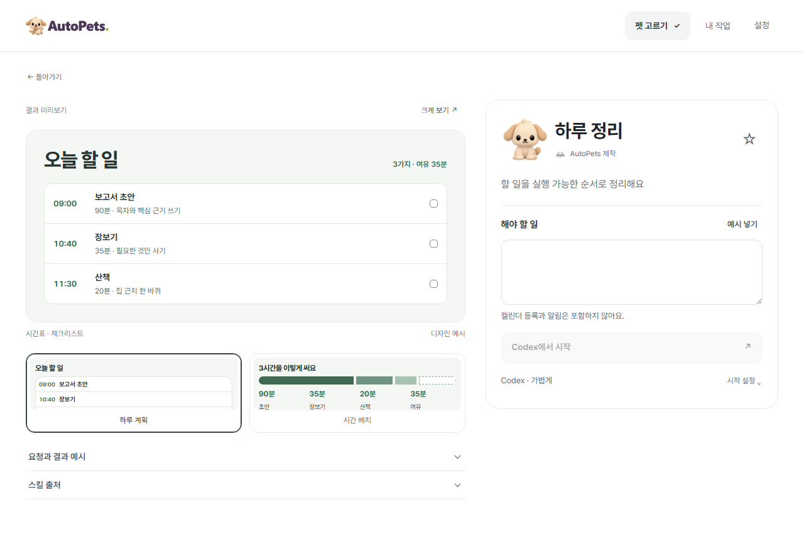 |

[좁은 창 이전](../changes/123/before-ux-narrow.png) · [좁은 창 변경 후](../changes/123/after-ux-narrow.png)

직전 결과 예시 버전과 같은 가상 데이터, 1280×880 또는 390×844 창, 배율 100%, 빈 요청 상태에서 비교한 **합성 검사**다. 390×844에서 시작 버튼 하단이 화면 위에서 1,200px 떨어진 자리에서 609px로 올라왔다. 같은 데이터로 992×688에서도 시작 버튼을 확인했다. 목록과 상세는 세 너비 모두 가로 넘침이 없었다.

후속 빌드와 전체 앱 UI 검사 76개가 통과했고 페이지 오류는 0개다. 키보드로 보조 메뉴와 요청 예시를 여는 동작, 예시를 넣은 뒤 입력칸으로 초점 이동, 제한 안내 노출, 다른 채팅과의 분리, 저장한 펫 재사용을 확인했다. 문서 링크와 펫 선택 영역의 담당 범위 검사도 통과했다. 제품 AI 호출은 0회였다.

Base44의 예시 옆 주요 버튼과 Notion의 갤러리 아래 세부 정보 배치를 참고했다. AutoPets에서는 결과 예시 옆에 입력과 시작을 함께 두고, 도구나 출처는 펼쳐서 확인하도록 적용했다. [Base44 화면](https://mobbin.com/screens/99003e47-b929-4a2b-9f3b-c6935042114d?utm_source=chatgpt&utm_medium=ai-assistant&utm_source_platform=mcp) · [Notion 화면](https://mobbin.com/screens/db686263-c5af-44cb-b9db-d1b8727d2616?utm_source=chatgpt&utm_medium=ai-assistant&utm_source_platform=mcp)

## 펫과 카드의 반응 정리 · 2026-11-27

목록에서는 펫과 역할 이름, 짧은 설명을 위에 모으고 그 아래에 결과 예시를 놓았다. 즐겨찾기는 소개 오른쪽에 있다. 상세도 같은 바탕과 소품을 써서 방금 고른 펫과 이어진다. 중간 너비에서는 두 결과를 나란히 볼 수 있고, 820px 이하에서는 한 열로 표시한다. 큰 창에서는 예시의 가로 공간을 넓혀 카드 한 줄이 더 높아진다.

| 이전 | 변경 후 |
| --- | --- |
| 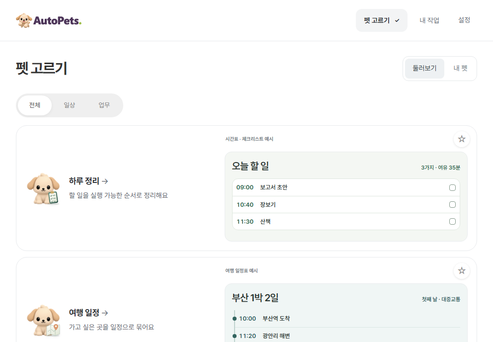 | 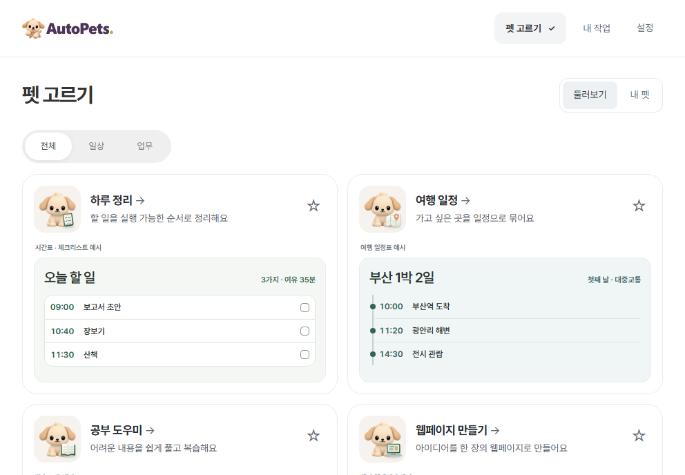 |
| 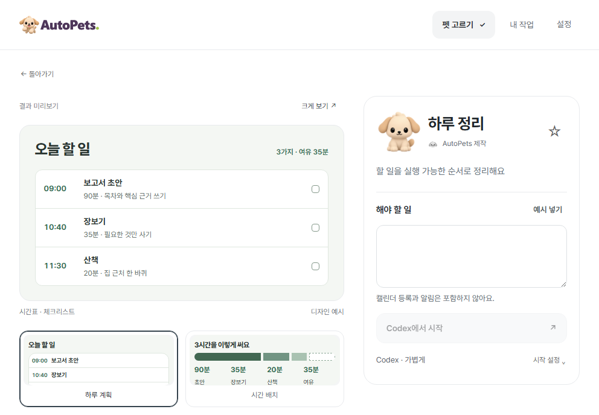 | 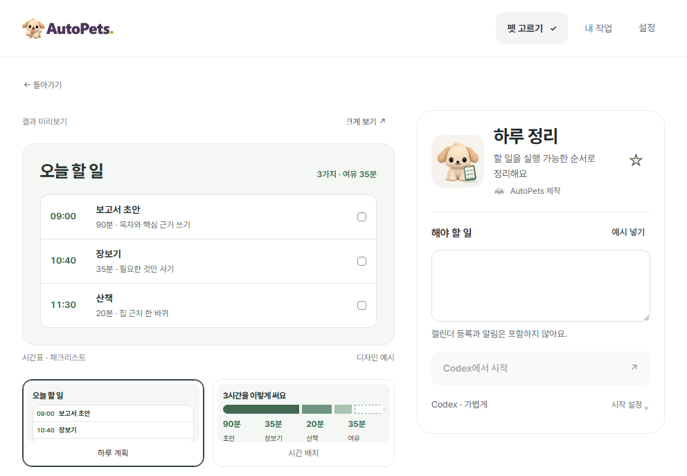 |

[펫 동작 이전](../changes/123/before-portrait-reaction.webm) · [펫 동작 변경 후](../changes/123/after-portrait-reaction.webm)

카드를 가리키거나 키보드로 초점을 옮기면 카드 색이 바뀌고 펫은 발 쪽을 중심으로 몸을 기울인다. 마우스나 초점이 떠나면 제자리로 돌아온다. 상세에 들어가면 같은 그림과 소품이 한 번 자리를 잡는다. 동작 줄이기 설정에서는 움직임 없이 카드 색과 초점 표시로 반응을 보여준다.

전후 화면과 영상은 992×688 창, 배율 100%, 가상 연결 상태에서 ‘하루 정리’ 펫으로 비교한 **합성 검사**다. 포인터를 올렸다 떼고 상세를 여는 동안 몸과 소품이 함께 움직이고 같은 그림 칸을 유지하는 것을 확인했다. 상세의 동작은 한 번 재생 뒤 멈췄다. 320·390·992·1280px에서도 가로 넘침과 시작 버튼 위치를 확인했다.

전체 앱 UI 검사 76개를 통과한 뒤 펫 주위 여백을 마지막으로 맞췄다. 최종 소스에서 빌드와 펫 선택·상세 검사 5개를 다시 통과했다. 제품 AI 호출은 0회였다.

캐릭터와 역할 설명을 붙이는 데 Canva 앱 목록과 Wix의 에이전트 소개 화면을 참고했다. 모션은 AutoPets의 기존 그림으로 브라우저에서 재현해 검사했다. [Canva 화면](https://mobbin.com/screens/c4c30fba-d21d-406f-945a-499b332e80e4?utm_source=chatgpt&utm_medium=ai-assistant&utm_source_platform=mcp) · [Wix 화면](https://mobbin.com/screens/0c82e69a-18d7-40bf-b28f-7dab1a4e4b9d?utm_source=chatgpt&utm_medium=ai-assistant&utm_source_platform=mcp)

## 결과를 보고 예시 요청 써 보기 · 2026-11-27

목록의 여섯 카드에서 맡길 일에 따라 다른 결과물을 보여준다. 하루 정리는 먼저 할 일과 여유 시간, 여행은 날짜별 동선, 공부는 개념과 적용 사례를 먼저 보여준다. 업무 펫에서는 행사 페이지, 홍보 제목·본문·버튼 문구, 발표 표지와 다섯 장의 흐름을 볼 수 있다. 예시는 동봉된 스킬의 출력 범위에 맞춰 작성했다.

| 이전 | 변경 후 |
| --- | --- |
| 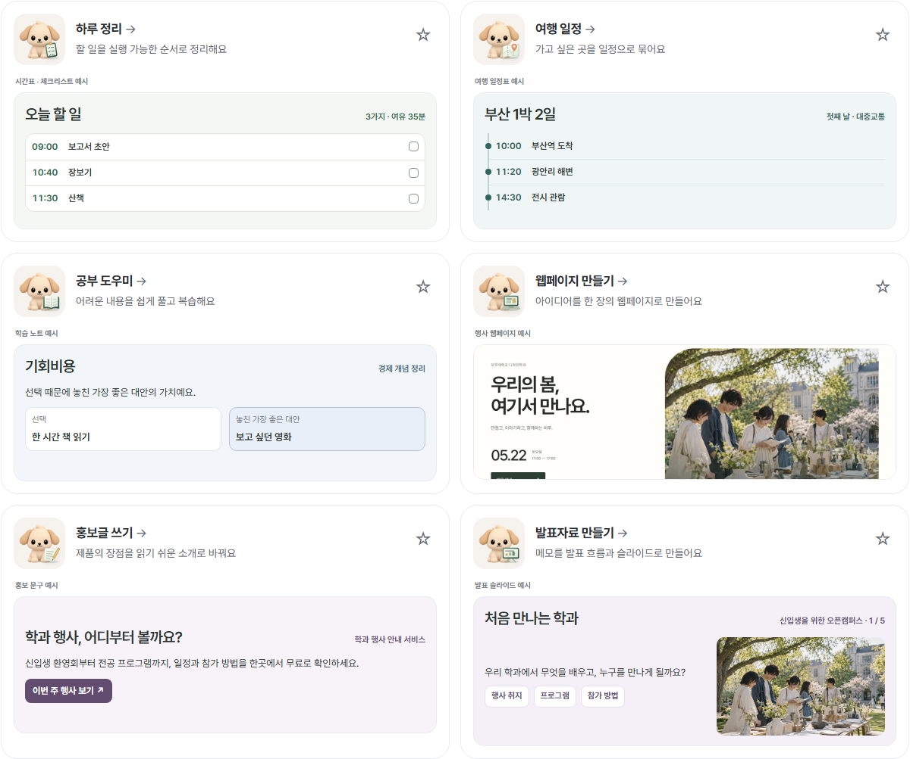 | 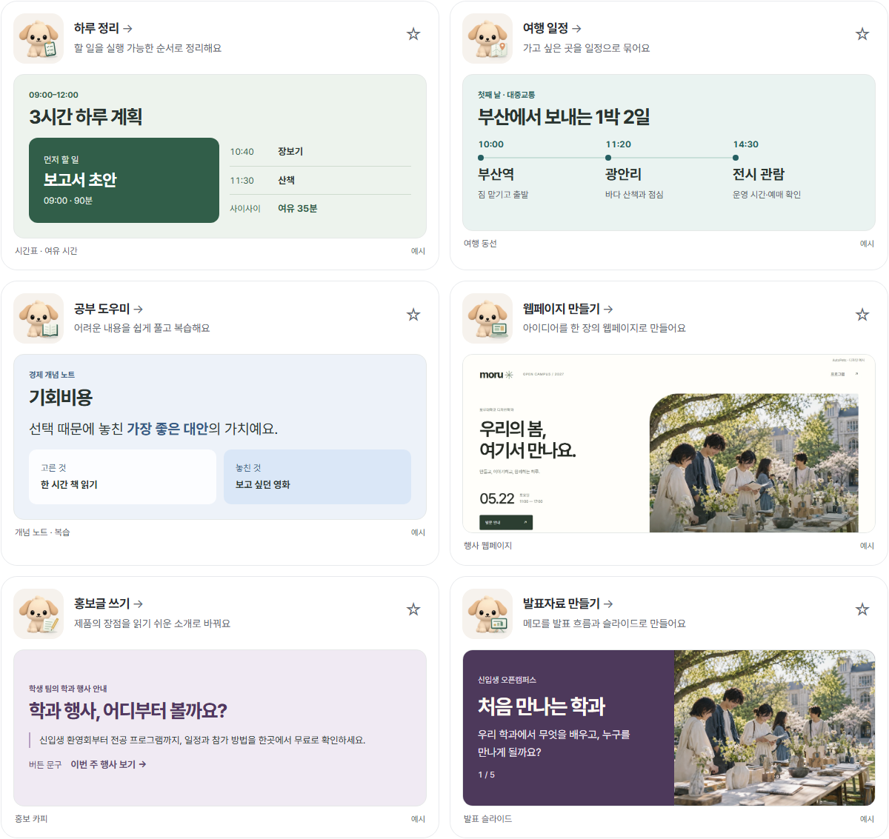 |
| 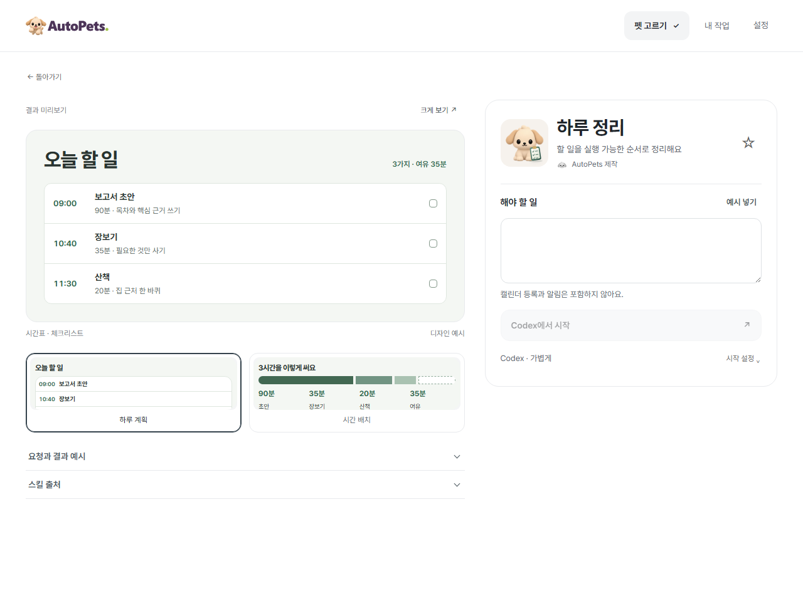 | 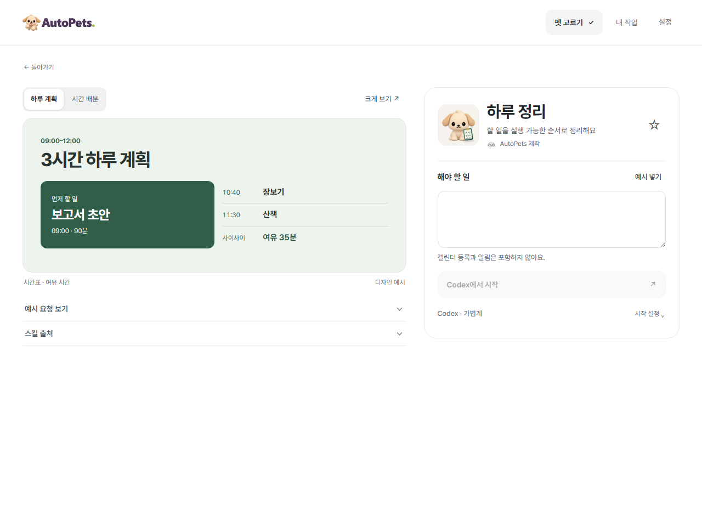 |

상세에서는 크게 보기 안에서도 다른 결과 화면을 고를 수 있다. 공부 예시의 복습 문제를 누르면 해설이 펼쳐진다. 빈 Codex 요청에서 ‘이 요청 써보기’를 누르면 예시 문장이 입력칸에 들어가고 바로 수정할 수 있다. 작성 중인 요청이 있으면 그 문장을 보존한다. [해설과 예시 요청 화면](../changes/123/after-deliverables-use.png)

1280×970 창과 배율 100%, 같은 가상 연결 상태에서 카드와 ‘하루 정리’ 상세를 비교했다. 320·390·661·992·1280px에서 가로 넘침과 발표 표지의 글자 잘림을 확인했다. 크게 보기에서 고른 화면이 상세에도 이어지고, 예시를 넣을 때 저장·연결·실행 요청이 발생하지 않는 것도 합성 검사로 확인했다. [복습 예시를 보고 요청에 넣는 영상](../changes/123/deliverables-example-to-request.webm)

최종 소스의 빌드와 전체 앱 UI 검사 76개가 통과했고 페이지 오류는 0개였다. 제품 AI 호출은 0회였다.

Canva에서 결과를 크게 보여주는 배치와 ChatGPT의 Figma 앱에서 실제로 적을 요청을 결과와 짝지어 보여주는 구성을 참고했다. AutoPets 예시는 역할별 가상 내용으로 구성했다. [Canva 화면](https://mobbin.com/screens/2629dc7b-2f25-41da-a5e4-0ec5a88d52b6?utm_source=chatgpt&utm_medium=ai-assistant&utm_source_platform=mcp) · [ChatGPT 화면](https://mobbin.com/screens/d9831938-eb61-4a95-b56f-9c0bde421cfc?utm_source=chatgpt&utm_medium=ai-assistant&utm_source_platform=mcp)

## 남은 확인과 인계

설치 앱·실제 AI 호스트 연결·결과 품질·사용자 편익을 통과시킨 검사는 아니다. 설치·배포와 실제 AI 시험은 이번 작업에 포함하지 않았다. 원래 앱 ID·데이터 위치·저장 데이터·공개 API·DB·대상 식별과 개정·재조회·중복 방지 계약은 유지했다.

관련 PR #97과 #119는 상세 화면·스타일이 겹친다. #103과 #115의 목록 카드 변경을 합칠 때에는 이번 펫 반응을 함께 확인한다. #120은 Codex 전송을 바꾸고, 그 위의 #124는 자동 시작·재연결과 상세의 연결 안내를 바꾼다. 어느 쪽을 먼저 병합하든 뒤쪽 PR의 실제 diff를 대조하고 영향받는 화면을 다시 확인한다. 브랜치는 `task/123-skill-detail`이며 최신 공유 상태와 다음 행동은 PR의 개발 기록을 따른다.
