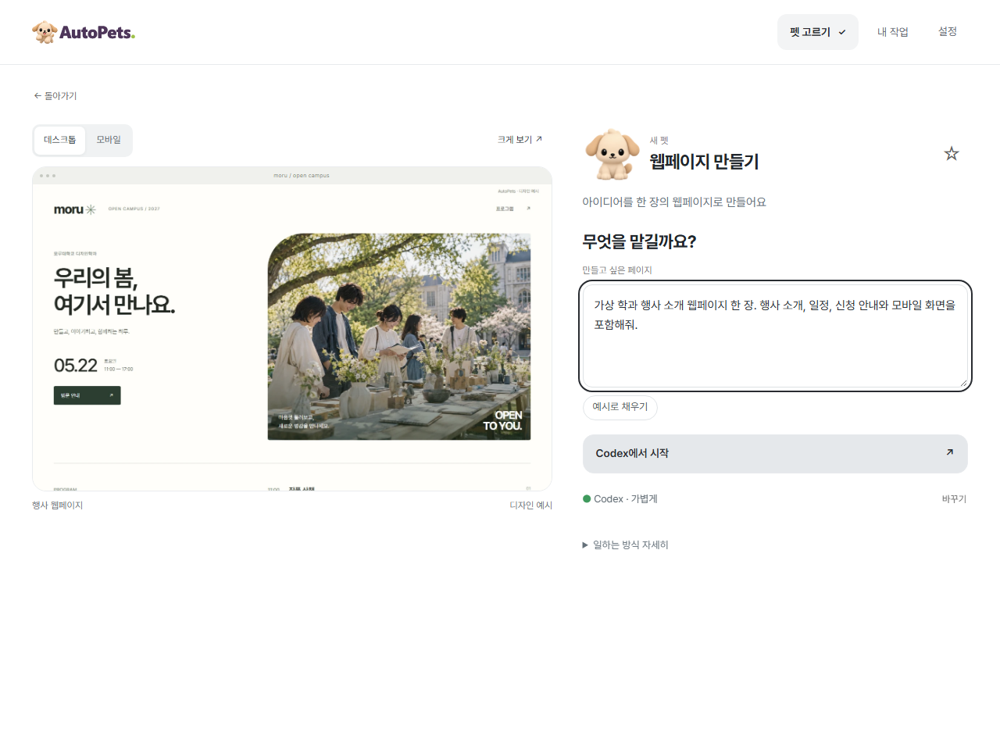

# 펫 상세 화면 검수

스킬을 고른 다음, 어떤 결과를 만들 수 있고 어디에서 시작하는지 쉽게 알 수 있도록 상세 화면을 정리했다. 사람 담당자는 승완(swaan-kim), 관련 작업은 [#123](https://github.com/swaan-kim/autopets/issues/123)이다.

## 사용 흐름과 비교 화면

1. 펫을 고르면 왼쪽에서 큰 결과 예시를 보고, 썸네일로 전체·세부 화면을 고른다. 웹페이지는 모바일 예시도 볼 수 있다.
2. 오른쪽에서 펫 소개를 읽고, 맡길 일을 적어 기존 시작 버튼을 누른다. 연결과 채팅 선택, 초안 저장은 기존 동작을 따른다.
3. 아래에서 요청·결과 예시를 이어 보고, 사용 안내와 스킬 출처를 확인한다.

요청·결과 예시는 미리 작성한 **디자인 예시**다. 실제 채팅이나 실행 결과가 아니며, 예시를 보는 것만으로 작업이나 연결을 시작하지 않는다. 전체·세부 썸네일은 같은 예시를 다른 범위로 보여준다.

| 이전 | 변경 후 |
| --- | --- |
|  |  |

두 화면은 같은 가상 행사 웹페이지 요청, 같은 저장·연결 상태, 1280×960 창, 배율 100%, 같은 글꼴과 브라우저에서 찍었다. 아래까지 보이도록 전체 페이지를 캡처했으므로 변경 후 이미지가 더 길다. 이전 화면은 시작 시점의 main(`f87334e7bc74c7e5ca4f730b3d6753a276b8ec40`), 변경 후는 이 PR의 구현이다.

[작은 창 화면](../changes/123/after-compact.png)은 992×688, 같은 입력과 상태다. 제목이 한 글자만 다음 줄로 떨어지지 않도록 다듬었고 시작 버튼까지 보인다. 760px 이하에서는 긴 예시보다 시작 카드가 먼저 나온다.

## 참고한 구성과 선택 이유

사용자가 제공한 [Agensi 상세 화면](https://www.agensi.io/skills/markov-multi-touch-attribution-budget-reallocation)을 기준으로 큰 미리보기와 썸네일, 오른쪽 소개·시작 카드, 아래의 요청·결과 예시를 배치했다. 색은 AutoPets의 기존 중성색과 브랜드 색을 유지했다.

Mobbin에서 확인한 [Base44](https://mobbin.com/screens/99003e47-b929-4a2b-9f3b-c6935042114d?utm_source=chatgpt&utm_medium=ai-assistant&utm_source_platform=mcp)의 미리보기와 시작 카드, [Notion](https://mobbin.com/screens/db686263-c5af-44cb-b9db-d1b8727d2616?utm_source=chatgpt&utm_medium=ai-assistant&utm_source_platform=mcp)의 갤러리와 상세 정보 구분, [ChatGPT](https://mobbin.com/screens/d9831938-eb61-4a95-b56f-9c0bde421cfc?utm_source=chatgpt&utm_medium=ai-assistant&utm_source_platform=mcp)의 요청·결과 예시 배치를 함께 참고했다. 참고 서비스의 화면 이미지는 제품이나 공개 자료에 넣지 않았다.

설명을 모두 숨기는 대신, 시작에 필요한 내용은 짧게 두고 결과 형식·제한·출처는 별도 카드에서 확인하게 했다. 페이지는 전보다 길어지지만 작은 창에서는 시작을 먼저 볼 수 있다. PowerPoint 미지원 같은 제한은 펼치지 않아도 보인다. 가격·평점·보안 검사 배지는 확인된 제품 정보가 없어 추가하지 않았다.

## 확인한 내용

Windows에서 기존 Playwright 검사 도구와 가상 연결 데이터를 사용했다. 실제 Codex·Claude를 호출하지 않았고 제품 AI 시험은 0회다.

| 검사 | 결과 |
| --- | --- |
| 프런트엔드 빌드 (`pnpm build`) | 통과. 기존 큰 번들 안내가 남는다. |
| Node 검사 (`pnpm test`) | 423개 중 421개 통과, 2개 건너뜀, 실패 0개. 건너뛴 항목은 실제 Codex CLI와 설치 파일 서명 검사다. |
| 전체 앱 UI 검사 (`ui-smoke.cjs`) | 76개 통과, 페이지 오류 0개. 여섯 펫의 갤러리·확대·키보드 조작, 초안·저장 구성, 대상 전환과 기존 시작·복귀 흐름을 포함한다. |
| 소개 페이지 UI·빌드·파일 패키지 검사 | 모두 통과. 외부 요청과 실제 AI 호출 없이 확인했다. |
| 담당 범위 검사 (`pnpm ui:scope`) | pet-selection의 제품·검사 파일과 home의 기존 UI 검사 파일 확인 완료. |
| 소개 생성 도구 검사 | 22개 통과. 생성물 31개의 재현 검사 통과. |
| 공백 검사 (`git diff --check`) | 통과. |

새 갤러리 검사는 키보드로 선택한 세부 화면이 확대 창에도 유지되고 Escape 후 원래 버튼으로 돌아오는지 확인한다. 예시 열람으로 실행·저장·연결이 발생하지 않는 기존 검사도 유지했다. 이미지가 없어도 입력과 시작을 막지 않는지 확인했다.

검사 중 기존 main의 로고 변경 이후 `docs/demo/index.html`이 생성 원본과 달라 자동 검사가 실패하는 것을 재현했다. 기존 `docs/design-source/build-assets.cjs`로 해당 생성물만 맞췄다. 생성 도구나 로고 원본, 모션은 바꾸지 않았다.

## 남은 확인과 인계

설치 앱·실제 AI 호스트 연결·결과 품질·사용자 편익을 통과시킨 검사는 아니다. 설치·배포와 실제 AI 시험은 이번 작업에 포함하지 않았다. 원래 앱 ID·데이터 위치·저장 데이터·공개 API·DB·대상 식별과 개정·재조회·중복 방지 계약은 유지했다.

관련 PR #97과 #119는 상세 화면·스타일이 겹치고, #115와 #120은 카드 예시와 Codex 전송을 다룬다. 재확인한 #124는 #120 위에 쌓인 자동 시작·재연결 작업이며, 상세의 연결 안내 문구도 바꾼다. 이 PR은 해당 PR을 미리 병합하거나 전송 기능을 대신 구현하지 않는다. 어느 쪽을 먼저 병합하든 나머지 PR의 실제 diff를 다시 보고 소개·시작·설정 영역을 조정해야 한다. 브랜치는 `task/123-skill-detail`이며 최신 공유 상태와 다음 행동은 PR의 개발 기록을 따른다.
