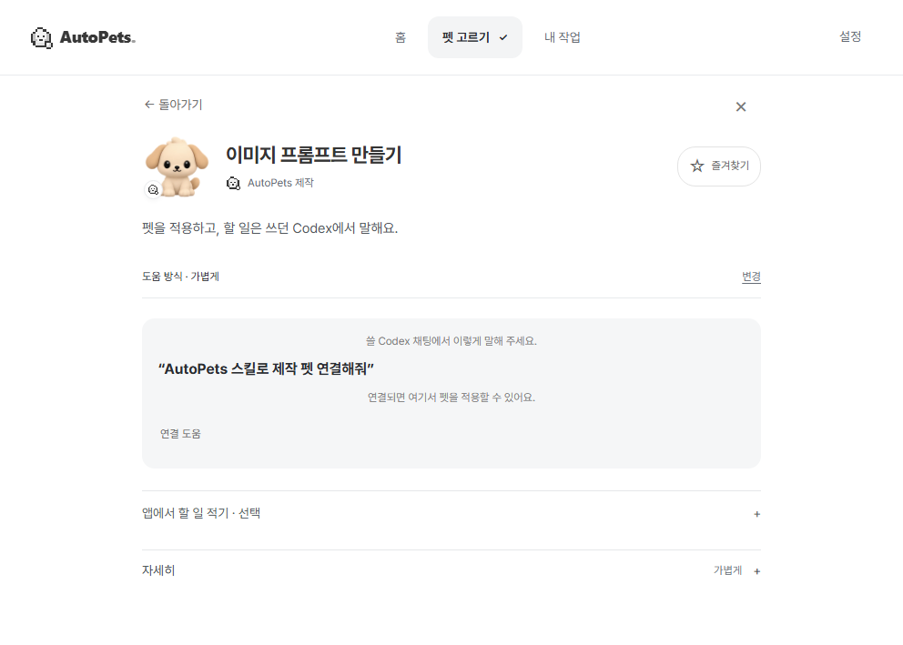
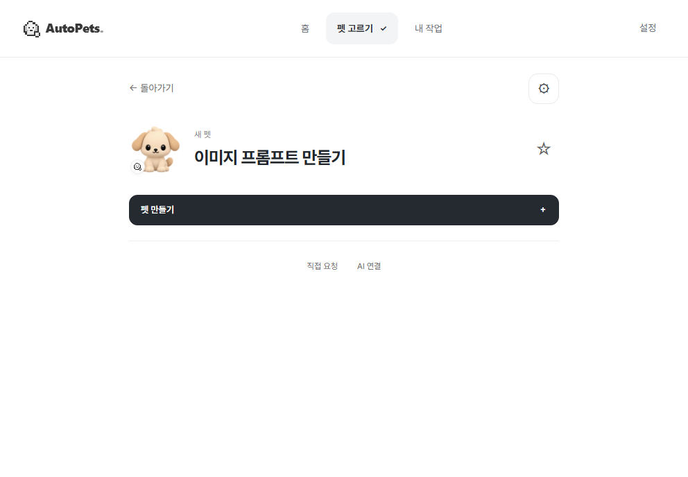

# 펫 준비 화면 간소화와 AI 연결 경로 확인

담당 @swaan-kim · [Issue #29](https://github.com/swaan-kim/autopets/issues/29). 기준 소스 `677d6e4c9d918c4032fc1c5955329ffd17220906`. 이 기록은 이번 작업의 화면 검사와 연결 조사이며 설치·실제 AI 활용·사용자 편익 판정과 구분한다.

## 바뀐 화면

채팅이 없어도 기존 저장 API로 **펫 만들기**를 할 수 있다. 연결된 Codex 대상이 있으면 선택 → 적용 → 별도 재조회로 확인 → 해당 채팅 열기 순서다. 기본 화면의 반복 연결 안내·스킬 호출 문장·중첩된 상세 메뉴를 제거하고 설정/직접 요청을 한 개의 편집 창으로 옮겼다. 스킬 원본·개정·이용 조건은 설정에서 유지한다.

연결이 없는 상태의 기본 화면은 같은 가상 데이터와 992×688, 배율 1에서 표시 문자가 194자에서 52자로 줄었다. 글자 수는 사용자 이해도나 편익의 통과 근거가 아니다.

| Before | After |
| --- | --- |
|  |  |

모두 **합성 UI 검사**다. 동일 이미지 예시를 선택한 상태이며 설치 앱의 실제 연결 성공 자료가 아니다. [저장 후](../changes/29/saved.png), [설정](../changes/29/settings.png), [직접 요청](../changes/29/request.png), [채팅 선택](../changes/29/selected.png), [적용 확인](../changes/29/applied.png), [합성 동작 영상](../changes/29/quick-use-flow.webm).

## 실제 앱에서 확인한 범위

| 환경 | 이번 관측 | 아직 확인하지 못한 부분 |
| --- | --- | --- |
| 설치된 AutoPets 검토판 | 기존 `feed9cd` 앱 실행, 읽기 기능 응답, 저장한 펫 목록 접근 가능 | 이번 UI는 아직 설치되지 않음. 기존 사용자 저장 내용은 수정하지 않음 |
| Codex URI를 처리하는 Windows 앱 `26.1029.7803.0` | 최초 시험 폴더 요청은 신뢰를 승인하지 않고 취소. 폴더 인수 없는 새 채팅에서 한글·공백·이모지 입력란 보존, Chat → Work 전환 후 문구 보존 확인 | Work 일반 입력 2회는 아래 원장처럼 연결/지침 읽기에 실패. 펫 적용·같은 채팅의 실제 작업·복귀 전체 흐름 미통과 |
| Claude Desktop `4.16336.0.0` | 메뉴 → 설정 → 확장 프로그램 → 고급 설정 → 패키지 미리보기로 이동. 실제 앱이 AutoPets 이름·개발자·버전·읽기 도구 2개를 표시하는 설치 확인 화면까지 준비 | 설치 버튼을 누르지 않음. Claude가 컴퓨터 전체 접근 권한을 고지하므로 사용자의 직접 확인 대기. 확장 실행·기존 대화에서 펫 읽기·결과 품질 미확인 |

화면 구현/합성 검사 시점의 제품 AI 요청은 0회였으며, 후속 실제 Work 일반 입력은 **부모 요청 2회**다. 펫 하위 작업 요청 0회, 제작용 이미지 생성 0회, 제품의 자동 전송 0회다. 두 요청은 이 담당자가 시험 채팅의 보내기 버튼으로 각각 한 번 제출했다. 앞선 작업의 AI 시험 원장과 제작 이력은 소급 수정하지 않는다. 원본 앱 화면·대화·개인 경로·진단은 공개 자료에 포함하지 않는다. 앱 시작이나 링크 처리만으로 연결 통과를 선언하지 않는다.

## 후속 실사용 원장

| 순서 | 범위와 결과 | 확인 수준 |
| --- | --- | --- |
| AI 없는 앱 진입 | 공식 새 채팅 URI에 고정 시험 문구를 넣어 실제 입력란의 한글·공백·이모지가 일치. Work 전환 후에도 유지 | 실제 앱 UI 관측. 채팅 전송/펫 연결을 증명하지 않음 |
| 부모 요청 1 | 전용 Work 채팅의 일반 입력으로 스킬 접근/현재 채팅 연결만 요청. 완료 응답은 설치된 스킬을 읽었다고 보고했지만 연결은 미완료. 현재 환경을 `codex_work_desktop`, 상태 조회를 `pet-connection-unavailable` 및 `Runtime transport closed`로 보고 | 요청 게시·완료 응답을 실제 UI에서 관측. 실행 로그 전체나 독립 메타데이터 대조로 승격하지 않음. 실제 일반 입력 연결 실패 |
| 독립 개발 확인 | 소스의 메타데이터 분류는 `codex_work_desktop`을 `work-local`로 구분하고, `inspectPetHost`는 `codex-local`만 허용. 현재 앱 실행 파일로 initialize만 한 STDIO 검사는 성공. 기존 proxy 경로의 시험 채팅 한 개 메타데이터 조회는 transport closed로 실패 | 코드·읽기 전용 프로토콜 검사. AI 요청·전체 채팅 조회·새 호스트 활성화 없음. 실제 Work 실패 원인이 허용 범위 한 가지뿐이라고 단정하지 않음 |
| 부모 요청 2 | 연결 재시도 대신 기존 MCP 코드로 선택한 영상 프롬프트 펫의 정확한 ID/개정/지침 해시를 읽는 분리 시제품 실행. Work의 한 번 실행은 읽기 실패, 원장 파일 미생성. Work는 재시도나 영상 프롬프트 작성을 하지 않고 종료 | 실제 Work 명령 실행을 포함하지만 MCP 확장 설치 경로는 아님. 설정 재사용/결과 품질 미통과 |
| 읽기 실패 대조 | 같은 bundled Node·기존 MCP STDIO 서버·동일 ID/개정/지침 해시를 개발 프로세스에서 읽기는 성공. 원래 검사 도우미의 해시 불변 확인. 개발 영수증과 Work 영수증을 다른 파일로 분리 | 앱 읽기 API·MCP 자체 성공을 Work/Claude 연결 성공으로 확대하지 않음. Work 실행 환경의 경로·권한·통신 중 어느 것이 원인인지는 미확정 |

각 부모 요청은 종료를 확인한 뒤 다음 목적의 검사를 시작했다. 실패한 연결/명령은 자동 재전송하지 않았다. 기존 저장 펫 수는 전후 동일하고 앱의 기존 연결 준비 상태도 유지됐다. 인증값·보안 설정·권한을 바꾸지 않았다. Work의 네트워크 제어가 별도로 존재한다는 [공식 설명](https://learn.chatgpt.com/docs/enterprise/chatgpt-work-overview#network-access-and-external-destinations)은 이 실패의 원인을 확정하는 근거로 사용하지 않는다.

Claude의 패키지 미리보기에는 `AutoPets · 저장한 펫 구성`, 개발자 `swaan-kim`, 버전 `0.1.0`, `autopets_list_pets`와 `autopets_read_pet`이 표시됐다. 선택한 고정 패키지의 SHA-256은 `f8a820918d9060e25942f5a6ddc6331eb99b609ec35d77f5a0c4adeca023e10c`다. 실제 파일 선택과 미리보기 파싱을 확인했으며 설치·권한 부여·호스트 실행과 구분한다. 코드가 읽기 전용이어도 Claude의 설치 권한 고지는 컴퓨터 전체 접근이므로 이 동의를 대신하지 않는다. [공식 MCPB 설치 단계](https://claude.com/docs/connectors/building/mcpb), [별도 Install 확인 단계](https://www.anthropic.com/research/desktop-extensions).

## 복사 없는 경로와 한계

1. **기존 Codex 채팅:** 현재 등록된 정확한 대상에 펫 설정을 적용하고 `codex://threads/<thread-id>`로 복귀하는 기존 계약을 유지한다. 대상 ID·폴더·개정·재조회·A/B 격리·중복과 늦은 응답 방지를 이번 합성 검사에서도 확인했다. 등록되지 않은 임의의 열린 채팅은 추측해 선택하지 않는다.
2. **Codex 새 채팅:** 공식 문서는 `codex://threads/new?prompt=…&path=…`를 제공한다. `prompt`는 입력란 초기값이고 전송이 아니다. 폴더 인수가 없는 로컬 시제품은 입력란과 Work 전환까지 확인했으며 제품 버튼으로 활성화하지 않았다. 새 채팅은 기존 채팅의 맥락 공유를 해결하지 않는다. [OpenAI 공식 명령 문서](https://learn.chatgpt.com/docs/reference/commands#chats).
3. **Claude Desktop:** 기존 읽기 전용 `.mcpb`를 한 번 설치하고 `autopets_list_pets` → 정확한 개정의 `autopets_read_pet`으로 지침을 가져오는 경로가 가장 작은 후속 검증 후보다. 공식 설치 위치는 Settings → Desktop app → Extensions의 Manage → Advanced settings → Install Extension이다. 앱에 표시한 **Claude 연결 파일**은 기존 내보내기 기능이며 설치나 연결 완료를 뜻하지 않는다. [Claude 로컬 확장 설치](https://support.claude.com/en/articles/10949351-getting-started-with-local-mcp-servers-on-claude-desktop), [로컬 확장과 원격 연결의 차이](https://support.claude.com/en/articles/11725091-when-to-use-desktop-and-web-connectors).
4. **ChatGPT 웹/Work:** 로컬 STDIO 패키지만으로 클라우드에 연결되지 않는다. 공식 Secure MCP Tunnel은 사설 MCP에 대한 후보지만 Platform 설정·터널 키·권한·호스트 연결 검증이 필요하다. 공개 플러그인 배포도 별도 조건이다. 이번에는 서버·키·계정·지원 플래그를 변경하지 않았다. [OpenAI Secure MCP Tunnel](https://developers.openai.com/api/docs/guides/secure-mcp-tunnels).
5. **Gemini:** CLI에는 로컬 MCP 설정 경로가 있다. 웹 Gemini에는 Connected Apps Platform의 원격 MCP 경로가 있으며 공식 가이드는 공개 HTTPS endpoint와 Developer Mode 검증, 등록·인증·게시 단계를 구분한다. 로컬 `.mcpb`와 동일한 설치 경로로 취급하지 않는다. 이번에는 Gemini 앱·계정·서버를 변경하지 않았다. [Gemini CLI MCP](https://geminicli.com/docs/tools/mcp-server/), [Google Connected Apps MCP 가이드](https://developers.google.com/connected-apps/mcp/).

현재 MCP는 선택한 펫의 **설정과 스킬 참조**를 읽는다. 스킬 본문을 실제 읽은 근거·실제 실행·모델 변경·다른 AI의 작업 상태 관측·전체 대화 공유·정확한 Claude/Gemini 채팅 복귀를 제공했다고 표시하지 않는다. 서로 다른 AI에서 같은 지침을 재사용하는 것과 대화 맥락을 공유하는 것은 별도로 검증한다.

## 검사

- `pnpm build`: 통과. TypeScript와 Vite production build, 기존 MCPB 패키징.
- `pnpm test`: 281개 중 280개 통과, 실제 미서명 설치 파일을 명시하지 않은 감사 1개 건너뜀. 실패 0개.
- `pet-quick-use-ui.cjs`: 미연결 저장, 실패·연속 클릭, 설정/직접 요청 전환, Escape 초점 복귀·키보드 가두기, 초안 보존, 992×688·661×459·375×812, 내보내기 오류/중복 통과.
- 기존 상세 UI 검사: 6개 역할의 원본·라이선스, 개정 충돌, 재선택 초점, 클립보드 실패, 지원하지 않는 조합, A 적용/B 보존 통과.
- `pnpm test:ui`: 전체 UI, 가상 사용자 검수 화면, 오프라인 패키지 검사 통과. 페이지 오류·패키지 외부 요청 0개. 초기 전체 검사에서 이전 접힌 메뉴/배경 버튼을 전제로 한 항목이 실패해 새 편집 창 순서로 수정했고, 개정 복구 초점의 비동기 반영을 기다린 뒤 확인하도록 고쳤다. PR 형식은 연결 PR의 최종 소스 기준 결과로 확인한다.
- 제품 소스 `f4944d2197b23aa2ed2c087b7a19ae5ecae0de94`의 [Windows CI](https://github.com/swaan-kim/autopets/actions/runs/41892499367)와 [PR 양식 검사](https://github.com/swaan-kim/autopets/actions/runs/41892499408) 통과. 후속 변경은 이 실사용 기록뿐이며 제품 코드·설치본은 그대로다.
- 저장소 구조·문서 상대 링크 검사 통과. 검수 패키지 빌드의 폰트 경로 경고는 실행 시 로컬 파일로 해결되며 오프라인 검사에서 `fontLoaded: true`를 확인했다.
- 영역 검사: `pet-selection`의 기존 등록 파일들과 `home`의 화면 단순화 검사 통과. 연결 내보내기 컴포넌트·공통 검사 도우미·신규 UI 검사는 Issue의 통합 담당 범위다.
- Rust·API·DB·CI·의존성·설치본은 변경하지 않아 Rust 검사·재설치·배포를 수행하지 않았다. 작은 화면 검사는 브라우저 배치 검사이며 Windows 실제 DPI 검증이 아니다.

## 바로 다음 행동

최초 시험 폴더 신뢰 요청은 담당자가 취소했으므로 그 화면을 승인할 필요가 없다. 현재 Work는 기존 Codex 로컬 경로와 같은 호스트라고 가정하지 않는다. 다음 연결 검증은 호스트 조회와 읽기 권한/통신 경계를 구분해 조사하고, 실제 호스트의 공식 로컬 MCP 설치 경로를 확인하는 것부터다. 개발용 명령의 성공을 사용자 설치 경험으로 대신하지 않는다. 새 호스트 지원의 합의 전에는 허용 목록·라우팅·권한을 넓히지 않는다.

Claude는 기존 MCPB의 설치 확인 화면을 준비했고 권한 확인은 사용자가 직접 한다. 승인/설치 여부를 실제 앱에서 다시 확인한 뒤 합성 펫의 목록·정확한 개정 읽기만 먼저 검증한다. 설치 결과를 확인하기 전 일반 입력이나 도구 요청을 보내지 않는다. 기존 대화 본문을 수집하거나 공개하지 않는다.

새 호스트 지원 활성화, 자동 요청 전달, 원격 MCP/터널 배포 또는 대화 맥락 공유의 계약은 사람 회의의 결론·이유·범위·참여자·날짜를 Issue #29에 기록한 뒤 해당 구현만 진행한다. 현재 화면 정리·기존 저장/적용·공식 조사와 독립 검사는 계속할 수 있다. 구현·병합·설치·배포·사용자 편익을 각각 구분한다.

## 전체 목표의 남은 근거

| 목표 | 현재 증거와 남은 범위 |
| --- | --- |
| 기존 AI에서 복붙 없이 펫 사용 | 입력란 진입과 기존 Codex 적용/복귀의 합성 검사는 있음. 현재 Work 실사용 2회는 실패, Claude는 실제 설치 권한 확인 대기. 기존 대화 맥락 공유·최신 일반 입력 전체 흐름 미완료 |
| 이미지·영상 예상 결과를 분류하고 따라 쓰기 | 기존 제품의 이미지/영상 필터·정적 제작 이미지·요청 예시·펫 설정 재사용은 있음. 실제 영상과 결과 품질·사용자 이해/편익 증거는 부족 |
| 작업 전·중·완료를 자연스럽게 잇는 펫 | 현재 강아지와 상태 전환·완료 중복 방지는 유지. 자연스러운 연속 동작은 아직 미완료. 보류된 캐릭터 20종 시안을 재개한 것으로 취급하지 않음 |
| 설치부터 사용자 편익까지 | 이번 UI는 아직 설치 앱 미반영. 보안 유지 새 PC 설치·일반 배포·사람 사용자 관찰은 별도 미완료 |

이 자료의 검사 통과나 연결 시제품을 전체 목표 달성으로 판정하지 않는다.
